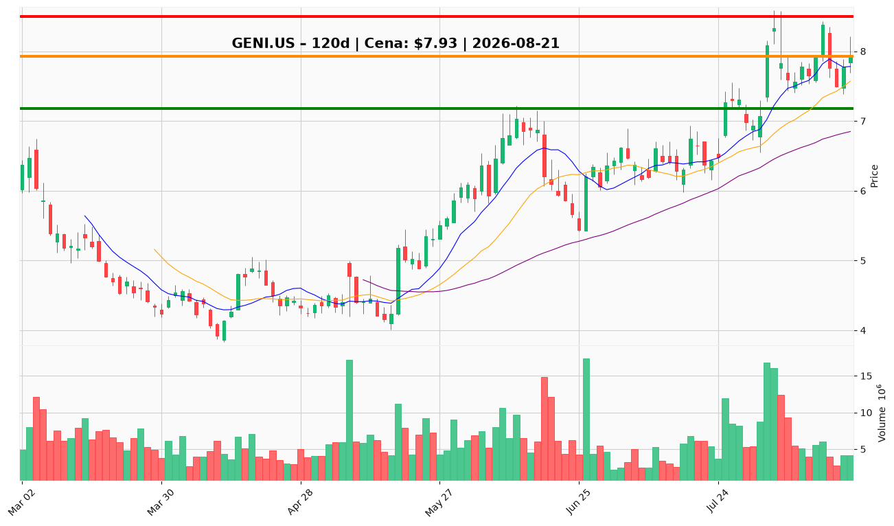

# GENI.US — Ticket posiadacza (2026-08-21)

**Werdykt:** HOLD  
**Horyzont:** swing (dni–tygodnie)  
**Cena ref.:** $7.93

**Pozycja zapisana:** wejście $8.28 | SL $7.19 | TP1 $8.43 | TP2 $9.25

| | Poziom | Uwagi |
|---|--------|------|
| **Akcja teraz** | Trzymaj | Nie dokupuj powyżej $8.20 przy ujemnym MACD; utrzymaj obecny rozmiar |
| **Stop-loss** | $7.18 | twardy — dzienne zamknięcie poniżej 200 SMA |
| **TP1** | $8.50 | redukcja części przy oporze / górnym paśmie Bollingera |
| **TP2** | $9.00 | wyjście reszty po potwierdzonym wybiciu powyżej $8.43 na wolumenie >~9M |

**Sizing / skala:** Utrzymaj obecną ekspozycję; nie zwiększaj alokacji przy cenie spot. Ryzyko ~0,75–1,0R na nogę swing (~0,5–1,0% kapitału do SL $7.18 od $7.93).

**Warunek dokupu** (jeśli ADD): Limit w strefie $7.50–$7.80 (klaster 10 EMA / VWMA, dołek z 18.08) lub potwierdzone wybicie powyżej $8.43 na wolumenie.

**Unieważnienie / pełne wyjście:** Dzienne zamknięcie poniżej $6.85 (50 SMA) — koniec tezy odbudowy średnioterminowej.

**Dlaczego (1–2 zdania):** Q2 pokazuje realny impuls operacyjny (+64,7% przychodów, marża 32,6%, EBITDA $42,9M), ale dźwignia ($821M długu, FCF -$190M) wymaga potwierdzenia w Q3. Cena trzyma stos MA powyżej kluczowych średnich — wyjście teraz oddaje asymetryczny upside przed sezonowymi katalizatorami.

**WERDYKT KOŃCOWY:** HOLD — utrzymaj pozycję, zarządzaj SL/TP według poziomów PM; dokup tylko na cofnięciu lub przy wybiciu.

