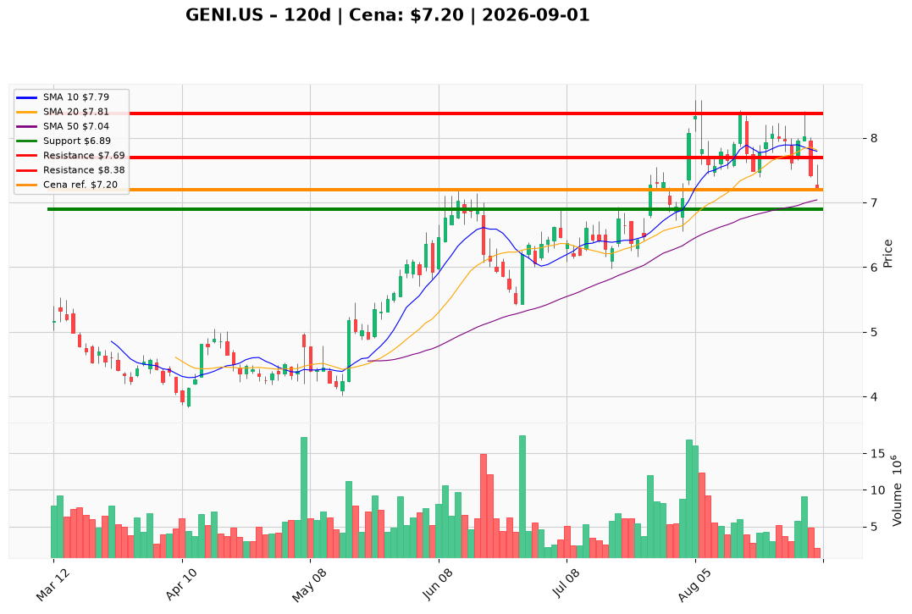

# GENI.US — Ticket posiadacza (2026-09-01)

**Werdykt:** REDUCE
**Horyzont:** swing (dni–tygodnie)
**Cena ref.:** $7.20

**Pozycja zapisana:** wejście $8.28 · SL $7.18 · TP1 $8.50 · TP2 $9.00 — P/L ok. **−13,0%** względem ceny ref.

| | Poziom | Uwagi |
|---|--------|------|
| **Akcja teraz** | trzymaj zredukowany rdzeń | bez dokupu; redukcja 30–40% przy odbiciu w strefę $7.69–$7.81 |
| **Stop-loss** | $6.89 | twardy; zamknięcie dzienne poniżej przy podwyższonym wolumenie unieważnia tezę odbicia |
| **TP1** | $7.69 | redukcja 30–40% przy 10 EMA / pierwszym oporze odbicia |
| **TP2** | $8.38 | wyjście z reszty przy strefie podażowej sierpnia; wymaga reclaimu VWMA $7.90 |

**Sizing / skala:** Utrzymaj rdzeń ≤1,0% portfela (beta 1,88, ryzyko luki −27% w lutym 2026). Przy odbiciu do $7.69–$7.81 sprzedaj 30–40% pozycji. Brak nowego kapitału — PM Underweight, sideline 0%.

**Warunek dokupu (ADD):** brak — potwierdzone wsparcie $7.04–$7.23 ze stabilizacją momentum lub reclaim VWMA $7.90 z wolumenem; do tego czasu zero dokupu.

**Unieważnienie / pełne wyjście:** zamknięcie dzienne poniżej $6.89 przy podwyższonym wolumenie — wyjście z całości; przy utrzymaniu się poniżej zapisanej strefy SL $7.18 bez odbicia — rozważ wcześniejszą redukcję rdzenia.

**Dlaczego (1–2 zdania):** Infleksja operacyjna (Q2 przychody +64,8% r/r, EBITDA +$42,9M) nie przekłada się na zaufanie rynku — spalanie FCF ~$190M H1, dług $821M, MACD pogłębia się (−0,111), dywergencja RSI niedźwiedzia. Przy wejściu $8.28 i cenie $7.20 pozycja jest pod wodą; PM rekomenduje Underweight i redukcję przy odbiciu, nie dokup.

**WERDYKT KOŃCOWY:** REDUCE — trzymaj zredukowany rdzeń ≤1% portfela, redukcja 30–40% @ $7.69–$7.81, twardy SL $6.89, TP1 $7.69 / TP2 $8.38; brak dokupu do potwierdzenia technicznego lub reclaimu VWMA.

