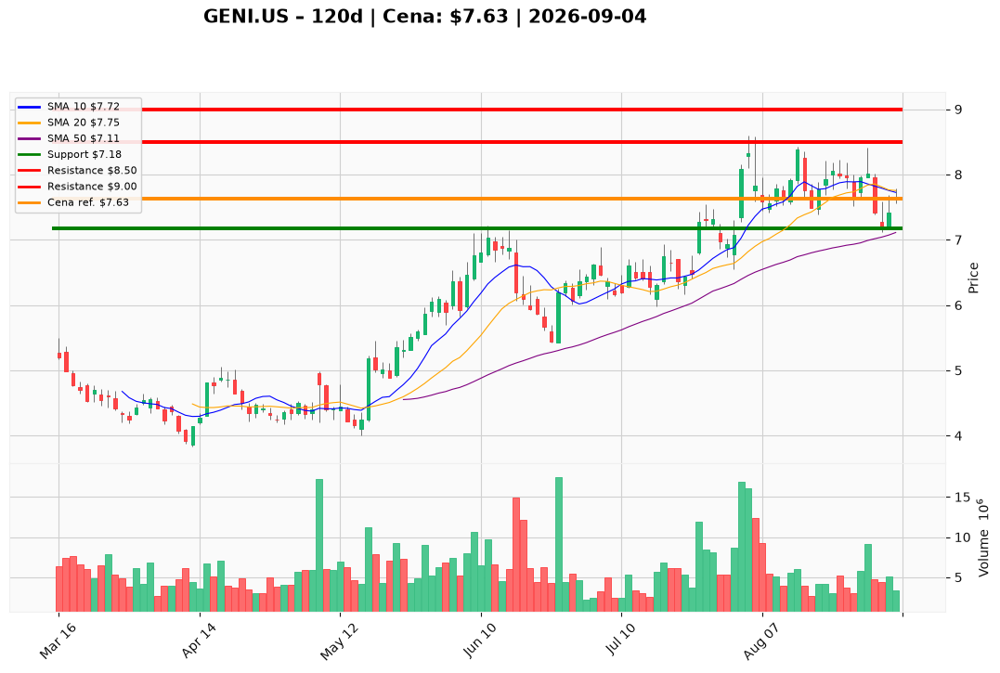

# GENI.US — Ticket posiadacza (2026-09-04)

**Werdykt:** HOLD
**Horyzont:** swing (dni–tygodnie)
**Cena ref.:** $7.63

**Pozycja zapisana:** wejście $8.28 | P/L: **-7,9%** ($-0.65/akcję)

| | Poziom | Uwagi |
|---|--------|------|
| **Akcja teraz** | Trzymaj | Bez dokupu — czekaj na powrót powyżej $8.00 |
| **Stop-loss** | $7.18 | Twardy — zamknięcie dzienne poniżej = wyjście |
| **TP1** | $8.50 | Redukcja 30–40% — strefa breakeven |
| **TP2** | $9.00 | Wyjście z reszty pozycji |

**Sizing / skala:** Utrzymaj pełną pozycję. Przy TP1 zrealizuj 30–40% aby zdejmować ryzyko blisko zera.

**Warunek dokupu:** Brak — dokup dopiero po zamknięciu powyżej $8.00 z RSI >55 i dodatnim histogramem MACD.

**Unieważnienie / pełne wyjście:** Zamknięcie dzienne poniżej $7.18 przy wolumenie >6M akcji — wtedy pełny exit.

**Dlaczego (1–2 zdania):** Genius Sports trzyma się powyżej 50 SMA ($7.11) po zdrowej korekcie post-earnings; infleksja EBITDA w Q2 i forward P/E ~7× wspierają tezę odwrócenia. Brak negatywnych newsów i momentum MACD słabnie, więc nie ma sensu dokupować — ale SL na $7.18 chroni przed powtórką luki z lutego.

**WERDYKT KOŃCOWY:** TRZYMAJ pozycję z wejścia $8.28 — SL $7.18, cele $8.50 / $9.00. Nie dokupuj do czasu powrotu powyżej $8.00.

