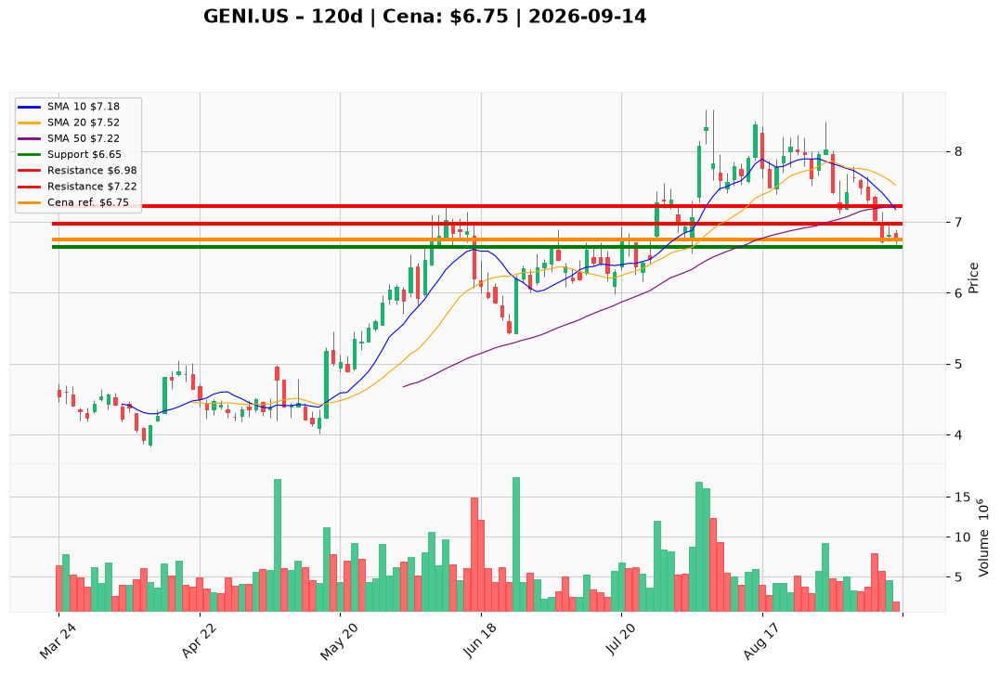

# GENI.US — Ticket posiadacza (2026-09-14)

**Werdykt:** HOLD
**Horyzont:** swing (dni–tygodnie)
**Cena ref.:** $6.75

**Pozycja zapisana (GENI.US):** wejście **$8.28** | SL zapisany **$7.18** (już przebity) | TP1 zapisany **$8.50** | TP2 zapisany **$9.00**.
**P/L vs 6.75:** **−$1.53 / akcję (−18,5%)**. Zapisane cele 8.50 / 9.00 są poza horyzontem tego swinga.

| | Poziom | Uwagi |
|---|--------|------|
| **Akcja teraz** | Trzymaj stub | bez dokupu @ $6.75; nadmiar ponad 0,5× jednostki swing — sprzedaj teraz; resztę tnij w bounce |
| **Stop-loss** | $6.65 | twardy — zamknięcie dzienne poniżej (PM nadpisuje zapisany $7.18) |
| **TP1** | $6.98 | redukcja części — 200 SMA |
| **TP2** | $7.22 | wyjście reszty stubu — 10 EMA / 50 SMA |

**Sizing / skala:** Tylko resztka **0,25–0,5×** pełnej jednostki swing (cel ~0,25×). Ryzyko ≤0,5–1,0% kapitału na ATR $0.42 (~6,1% spot); nie sizinguj do luki $0.10 do 6.65 (kieszeń 27% z 5 lutego). Zero nowego kapitału.

**Warunek dokupu** (jeśli ADD): Brak. ADD zablokowany przy $6.75. Re-rate dopiero po zamknięciu dziennym **>$7.22** z histogramem MACD odwracającym z ~−0.15 i RSI przez 45–50.

**Unieważnienie / pełne wyjście:** Zamknięcie dzienne **<$6.65** → tnij resztę, nie bronić $6.20 / $5.86–$5.94.

**Dlaczego (1–2 zdania):** PM Hold: Q2 operacyjnie lepsze, ale GAAP −$77M, dług netto $630M i taśma pod 10/50/200 SMA z MACD −0.133 — nie nożownik przy 6.65–6.70. Lot z $8.28 jest głęboko pod wodą i pod zapisanym SL; zostaje stub, trim w $6.98 / $7.22, bez uśredniania.

**WERDYKT KOŃCOWY:** HOLD — utrzymaj zapisaną pozycję GENI.US (wejście $8.28; P/L −18,5%) jako stub 0,25–0,5× bez dokupu; SL **$6.65**, TP1 **$6.98**, TP2 **$7.22** (zapisane 7.18 / 8.50 / 9.00: SL już za nami, cele swinga nadpisane przez PM).

