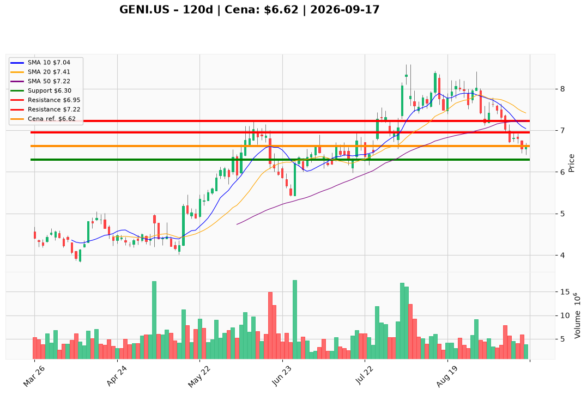

# GENI.US — Ticket posiadacza (2026-09-17)

**Werdykt:** HOLD
**Horyzont:** swing (dni–tygodnie)
**Cena ref.:** $6.62

| | Poziom | Uwagi |
|---|--------|------|
| **Akcja teraz** | Trzymaj | Brak dokupu — trend spadkowy, czekaj na odwrócenie powyżej $7.00 |
| **Stop-loss** | $6.30 | Twardy — poniżej dołka z 15.09 ($6.41) |
| **TP1** | $6.95 | Redukcja ~30% — strefa 200 SMA |
| **TP2** | $7.22 | Wyjście z reszty — 50 SMA |

**Pozycja zapisana:** wejście $8.28 | P/L: **-20,0%** vs cena ref.

**Sizing / skala:** Utrzymaj obecną wielkość pozycji. Nie dokupuj — beta 1.88 i $821M długu po akwizycji zwiększają ryzyko. Przy TP1 zrealizuj ~30%, resztę przy TP2 lub trail.

**Warunek dokupu:** Zamknięcie dzienne powyżej $7.00 z RSI > 45 i rosnącym wolumenem.

**Unieważnienie / pełne wyjście:** Zamknięcie dzienne poniżej $6.30 na wolumenie — wyjdź w całości.

**Dlaczego (1–2 zdania):** GENI spadł 13% w dwóch tygodniach bez złych newsów — korekta techniczna przy wzroście przychodów +65% r/r i P/E fwd ~6x. Liga MX to pozytywny katalizator, ale MACD (-0.14) i dług po akwizycji wymagają ciasnego SL. Przy wejściu $8.28 trzymamy z defensywnym zarządzaniem, celując w odbicie do SMA.

**WERDYKT KOŃCOWY:** HOLD — trzymaj pozycję ze stop-loss $6.30, realizuj zyski częściowe przy $6.95 i $7.22; nie dokupuj do odwrócenia trendu.

