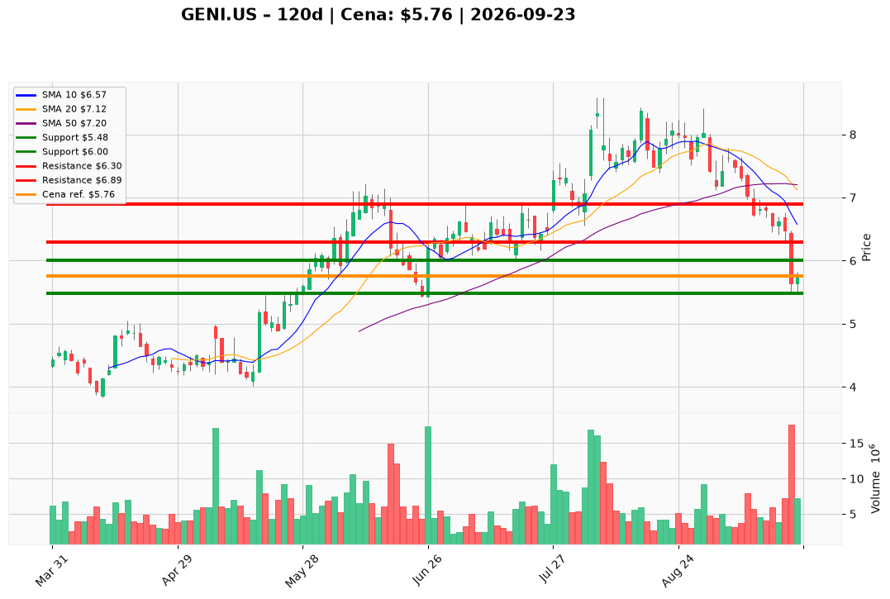

# GENI.US — Ticket posiadacza (2026-09-23)

**Werdykt:** EXIT
**Horyzont:** swing (dni–tygodnie)
**Cena ref.:** $5.76

| | Poziom | Uwagi |
|---|--------|------|
| **Akcja teraz** | Sprzedaj ~70% @ market | Stop $6.30 naruszony 18.09 — zamknij większość pozycji |
| **Stop-loss** | $5.48 | Twardy — dla reszty; zamknięcie dzienne poniżej = wyjście w całości |
| **TP1** | $6.00 | Redukcja reszty przy odbiciu (dead-cat bounce) |
| **TP2** | $6.30 | Wyjście z pozostałych akcji — re-test starego SL |

**Pozycja zapisana:** wejście $8.28 | P/L: **−30,4%** vs cena ref.

**Sizing / skala:** Zrealizuj ~70% pozycji natychmiast po cenie rynkowej (~$5.76). Maks. 30% może zostać tylko ze stop-loss $5.48 — nie dokupuj. Beta 1.88 i D/E 120% zwiększają ryzyko spadku do $3.83 (dołek 52T).

**Warunek dokupu:** Brak — nie dokupuj. Re-entry tylko po zamknięciu dziennego powyżej $6.89 (200 SMA) z RSI > 45.

**Unieważnienie / pełne wyjście:** Zamknięcie dzienne poniżej $5.48 — wyjdź z całej pozostałej pozycji. Poprzedni SL $6.30 został już aktywowany 18.09 (zamknięcie $5.64, wolumen 17,5M).

**Dlaczego (1–2 zdania):** GENI spadł kolejne 13% po ostatniej analizie, przełamując stop $6.30 na kapitalizacji wolumenu. MACD (−0.37) i utrata 200 SMA ($6.89) wskazują na kontynuację trendu spadkowego mimo taniego P/E fwd ~5,7x i dealu Liga MX. Dyscyplina swing wymaga redukcji po naruszeniu invalidation.

**WERDYKT KOŃCOWY:** EXIT — sprzedaj ~70% natychmiast, resztę trzymaj max. ze stop-loss $5.48; realizuj odbicia przy $6.00 i $6.30; nie dokupuj.

