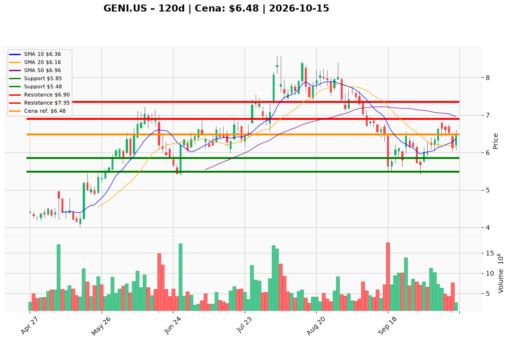

# GENI.US — Ticket posiadacza (2026-10-15)

**Werdykt:** HOLD
**Horyzont:** swing (dni–tygodnie)
**Cena ref.:** $6.48

**Pozycja zapisana:** wejście $8.28 | poprzedni SL $5.48, TP $6.00 / $6.30 | P/L: **−21,7%** ($−1,80/akcję)

| | Poziom | Uwagi |
|---|--------|------|
| **Akcja teraz** | Trzymaj | Bez dokupu; opcjonalnie redukcja 25% jeśli nie zrealizowałeś celów przy $6.00–$6.30 |
| **Stop-loss** | $5.85 | Twardy — zamknięcie dzienne poniżej = wyjście z reszty |
| **TP1** | $6.90 | Redukcja ~25–30% |
| **TP2** | $7.35 | Kolejne ~30%; reszta z trailingiem |

**Sizing / skala:** Utrzymaj rdzeń pozycji. Nie dokupuj do czasu zamknięcia dziennego powyżej **$6.85** (wolumen ≥5M). Jeśli wcześniejsze TP ($6.00/$6.30) nie były realizowane, rozważ częściową redukcję teraz (~25%) i prowadź resztę według nowych poziomów.

**Warunek dokupu:** Brak przy cenie rynkowej — dokup tylko po breaku **> $6.85** z potwierdzeniem wolumenu.

**Unieważnienie / pełne wyjście:** Zamknięcie dzienne **< $5.85** przy wolumenie >7M — pełny exit (odbicie reliefowe nie utrzymało bazy październikowej).

**Dlaczego (1–2 zdania):** GENI odbił się z dołka ~$5.5, odzyskał 200 SMA i pokazuje dodatni histogram MACD, ale wciąż jest pod 50 SMA i Twoim kosztem $8.28. PM: trzymaj z podniesionym SL $5.85 i celami $6.90 / $7.35 — fundamenty (FCF, niski fwd P/E, EBITDA Q2) wspierają cierpliwość, beta i zadłużenie przemawiają przeciw dokupowi.

**WERDYKT KOŃCOWY:** TRZYMAJ — SL $5.85, realizuj częściowo przy $6.90 i $7.35; nie dokupuj bez zamknięcia powyżej $6.85.

