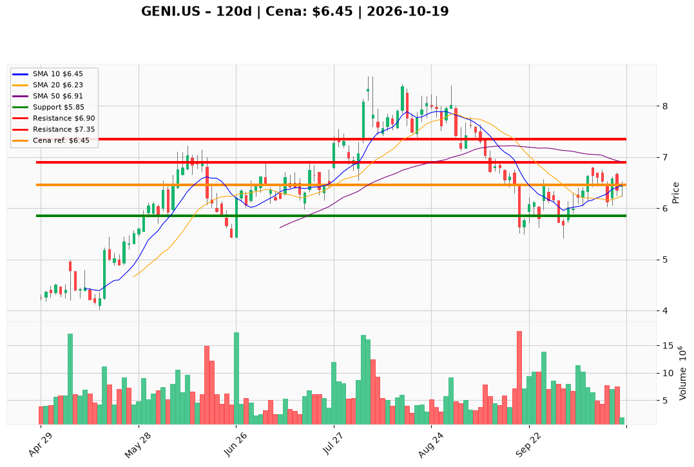

# GENI.US — Ticket posiadacza (2026-10-19)

**Werdykt:** HOLD
**Horyzont:** swing (dni–tygodnie)
**Cena ref.:** $6.45

**Pozycja zapisana:** wejście $8.28 | SL $5.85, TP $6.90 / $7.35 | P/L: **−22,1%** ($−1,83/akcję)

| | Poziom | Uwagi |
|---|--------|------|
| **Akcja teraz** | Trzymaj | Bez dokupu; opcjonalnie redukcja ~25% jeśli nie zrealizowałeś wcześniejszych celów przy $6.00–$6.30 |
| **Stop-loss** | $5.85 | Twardy — zamknięcie dzienne poniżej = wyjście z reszty |
| **TP1** | $6.90 | Redukcja ~25–30% |
| **TP2** | $7.35 | Kolejne ~30%; reszta z trailingiem |

**Sizing / skala:** Utrzymaj rdzeń pozycji. Nie dokupuj do czasu zamknięcia dziennego powyżej **$6.85** (wolumen ≥5M). Konsolidacja $6.35–$6.45 nad 200 SMA nie zmienia planu — nadal zarządzaj według SL/TP.

**Warunek dokupu:** Brak przy cenie rynkowej — dokup tylko po breaku **> $6.85** z potwierdzeniem wolumenu.

**Unieważnienie / pełne wyjście:** Zamknięcie dzienne **< $5.85** przy wolumenie >7M — pełny exit (odbicie nie utrzymało bazy październikowej).

**Dlaczego (1–2 zdania):** GENI trzyma 200 SMA (~$6.42) z dodatnim histogramem MACD, ale wciąż jest pod 50 SMA i Twoim kosztem $8.28. PM: trzymaj z SL $5.85 i celami $6.90 / $7.35 — FCF i niski fwd P/E wspierają cierpliwość, beta i zadłużenie przemawiają przeciw dokupowi.

**WERDYKT KOŃCOWY:** TRZYMAJ — SL $5.85, realizuj częściowo przy $6.90 i $7.35; nie dokupuj bez zamknięcia powyżej $6.85.

