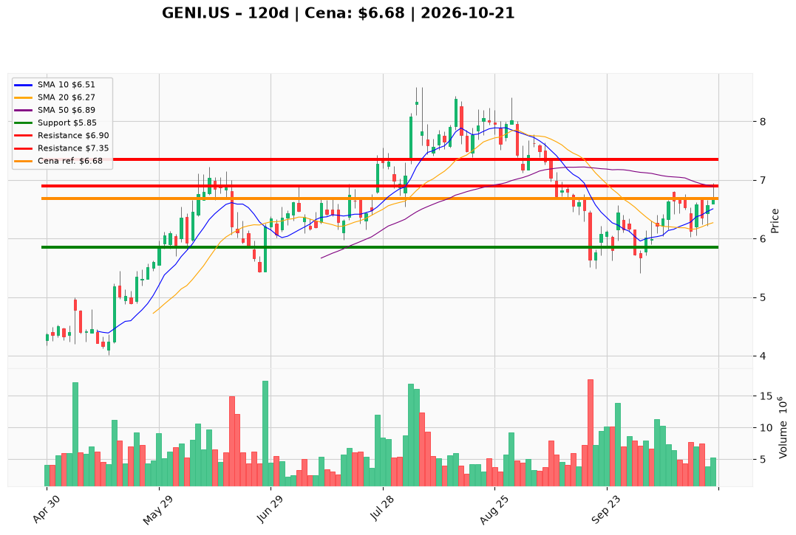

# GENI.US — Ticket posiadacza (2026-10-21)

**Werdykt:** HOLD
**Horyzont:** swing (dni–tygodnie)
**Cena ref.:** $6.68

**Pozycja zapisana:** wejście $8.28 | SL $5.85, TP $6.90 / $7.35 | P/L: **−19,3%** ($−1,60/akcję)

| | Poziom | Uwagi |
|---|--------|------|
| **Akcja teraz** | Trzymaj | Rozważ redukcję ~25–30% przy pierwszym dotknięciu **$6.90** (50 SMA); bez dokupu na rynku |
| **Stop-loss** | $5.85 | Twardy — zamknięcie dzienne poniżej = wyjście z reszty |
| **TP1** | $6.90 | Redukcja ~25–30% |
| **TP2** | $7.35 | Kolejne ~30%; reszta z trailingiem |

**Sizing / skala:** Utrzymaj rdzeń. Cena testuje strefę **$6.85–$6.91** — nie gonij; realizuj część według TP1 jeśli jeszcze nie zrobiłeś. Dokup tylko po zamknięciu dziennego **> $6.90** (wolumen ≥5M).

**Warunek dokupu:** Brak przy cenie rynkowej — dokup po breaku **> $6.90** z potwierdzeniem wolumenu.

**Unieważnienie / pełne wyjście:** Zamknięcie dzienne **< $5.85** przy wolumenie >7M — pełny exit.

**Dlaczego (1–2 zdania):** GENI zamknął wyżej ($6.68) z dodatnim histogramem MACD i nad 200 SMA, ale wciąż pod 50 SMA i Twoim kosztem $8.28. PM: trzymaj z SL $5.85 i celami $6.90 / $7.35 — pierwszy cel jest na wyciągnięcie ręki; FCF i niski fwd P/E wspierają cierpliwość, beta i zadłużenie przemawiają przeciw dokupowi.

**WERDYKT KOŃCOWY:** TRZYMAJ — realizuj częściowo przy $6.90 i $7.35; SL $5.85 bez zmian; nie dokupuj bez zamknięcia powyżej $6.90.

