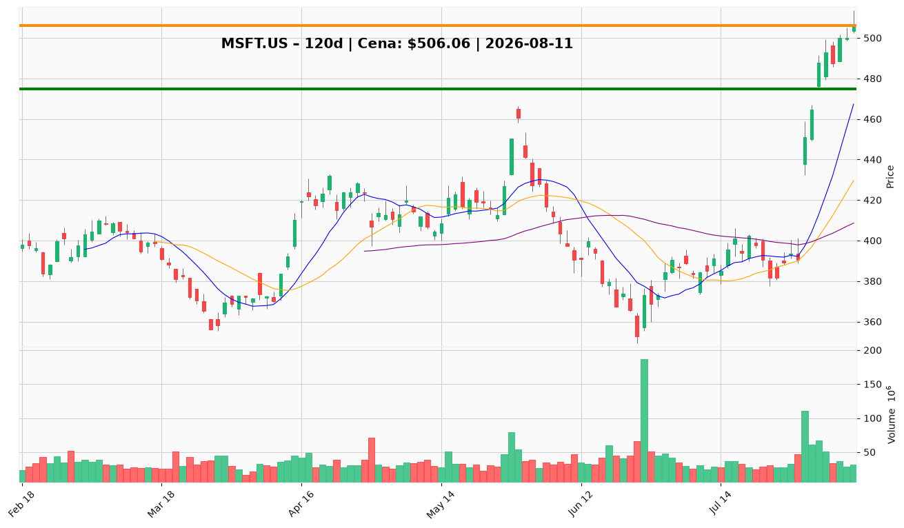

# MSFT.US — Ticket posiadacza (2026-08-11)

**Werdykt:** HOLD
**Horyzont:** position (tygodnie–miesiące)
**Cena ref.:** $506.06

| | Poziom | Uwagi |
|---|--------|------|
| **Akcja teraz** | trzymaj | brak dokupu powyżej $500; nie sprzedawać na rynku |
| **Stop-loss** | $475.00 | twardy (trailing) — zamknięcie poniżej 03.08 anuluje parabolę |
| **TP1** | $518.00 | redukcja ~1/3 (górna wstęga Bollingera / strefa podaży) |
| **TP2** | $540.00 | redukcja kolejnej ~1/3 w ścianę 538–553; runner na 553+ |

**Pozycja zapisana:** wejście $498.63 (06.08.2026), obecnie +1.5%.

**Sizing / skala:** pełna pozycja trzymana; 1/3 wyjścia @ TP1, 1/3 @ TP2, mały runner na wybicie $553. Zero nowych aktywów powyżej $500.

**Warunek dokupu (jeśli ADD):** brak teraz — dokup tylko na retescie 430–470 (okolice 200 SMA) z potwierdzeniem i stopem < $415.

**Unieważnienie / pełne wyjście:** dzienne zamknięcie < $475 — wyjście reszty pozycji.

**Dlaczego (1–2 zdania):** Fundamenty mocne (przychody +17.7% r/r, EPS +32%, chip Maia 300 i deal energetyczny Project Kilby), ale wykres paraboliczny (RSI 79, +30% w 9 sesji, podaż 518–553) i spadający FCF — trzymaj z podciągniętym stopem i redukcją w górę.

**WERDYKT KOŃCOWY:** HOLD — trzymaj pozycję, stop trailing na $475, redukcja części przy $518 i $540, bez dokupów powyżej $500.

