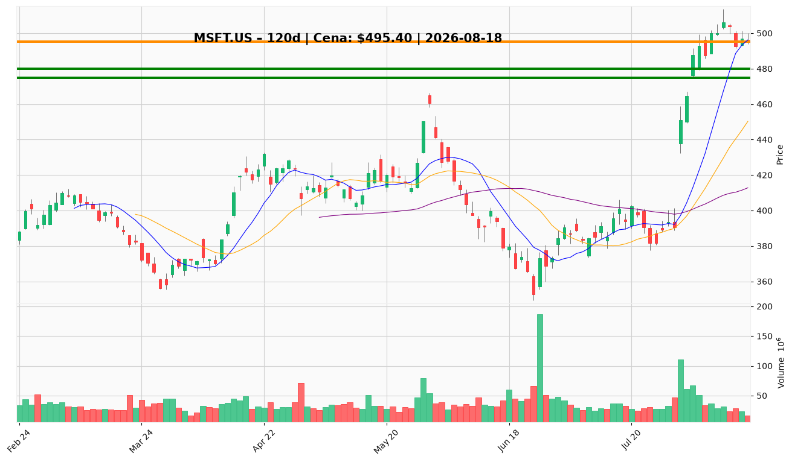

# MSFT.US — Ticket posiadacza (2026-08-18)

**Werdykt:** HOLD
**Horyzont:** position (tygodnie–miesiące)
**Cena ref.:** $495.40

| | Poziom | Uwagi |
|---|--------|------|
| **Akcja teraz** | trzymaj | brak dokupu powyżej $500; nie sprzedawać na pullbacku do $486 |
| **Stop-loss** | $475.00 | twardy — zamknięcie dzienne poniżej anuluje strukturę wybicia |
| **TP1** | $518.00 | redukcja ~1/3 (strefa podaży / górna wstęga) |
| **TP2** | $540.00 | redukcja kolejnej ~1/3; runner na wybicie $553 (Bollinger upper) |

**Pozycja zapisana:** wejście $498.63, SL $475.00, TP1 $518.00, TP2 $540.00 — obecnie ~-0.6%.

**Sizing / skala:** pełna pozycja trzymana; 1/3 wyjścia @ TP1, 1/3 @ TP2, mały runner na $553+. Zero nowych aktywów powyżej $500.

**Warunek dokupu (jeśli ADD):** brak teraz — dokup tylko na retescie $450–470 (okolice 200 SMA / środek Bollingera) z potwierdzeniem i stopem < $415.

**Unieważnienie / pełne wyjście:** dzienne zamknięcie < $475 — wyjście reszty pozycji. Miękki sygnał: zamknięcie < $480 (10 EMA) → rozważ redukcję 25%.

**Dlaczego (1–2 zdania):** Fundamenty mocne (EPS $4.81, marża operacyjna ~50%, AI monetization), trend wzrostowy utrzymany powyżej wszystkich MA, ale wykres wykupiony (RSI 71, histogram MACD słabnie) i presja nagłówkowa (Chiny, capex) — trzymaj z podciągniętym stopem i redukcją w górę, bez dokupów.

**WERDYKT KOŃCOWY:** HOLD — trzymaj pozycję, stop na $475, redukcja części przy $518 i $540, bez dokupów powyżej $500.

