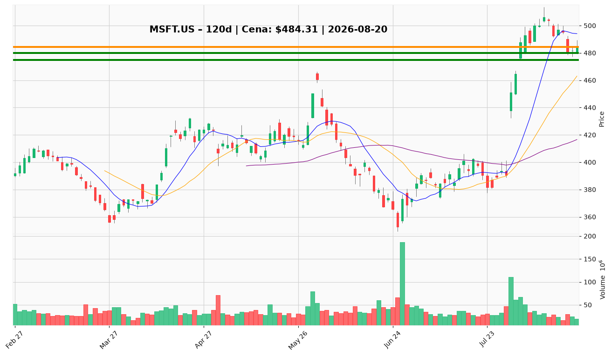

# MSFT.US — Ticket posiadacza (2026-08-20)

**Werdykt:** HOLD
**Horyzont:** position (tygodnie–miesiące)
**Cena ref.:** $484.31

| | Poziom | Uwagi |
|---|--------|------|
| **Akcja teraz** | trzymaj | brak dokupu powyżej $500; nie sprzedawać na pullbacku do $480 |
| **Stop-loss** | $475.00 | twardy — zamknięcie dzienne poniżej anuluje strukturę wybicia |
| **TP1** | $518.00 | redukcja ~1/3 (strefa podaży) |
| **TP2** | $540.00 | redukcja kolejnej ~1/3; runner na wybicie $553 |

**Pozycja zapisana:** wejście $498.63, SL $475.00, TP1 $518.00, TP2 $540.00 — obecnie ~-2.9%.

**Sizing / skala:** pełna pozycja trzymana; 1/3 wyjścia @ TP1, 1/3 @ TP2, mały runner na $553+. Zero nowych aktywów powyżej $500.

**Warunek dokupu (jeśli ADD):** brak teraz — dokup tylko na retescie $450–470 (okolice 200 SMA / środek Bollingera) z potwierdzeniem i stopem < $415.

**Unieważnienie / pełne wyjście:** dzienne zamknięcie < $475 — wyjście reszty pozycji. Miękki sygnał: zamknięcie < $480 (10 EMA) z rosnącym wolumenem → rozważ redukcję 25%.

**Dlaczego (1–2 zdania):** Fundamenty mocne (EPS $4.81, marża operacyjna 45%, backlog $678B), trend średnioterminowy utrzymany powyżej 50/200 SMA, ale momentum krótkoterminowe słabnie (MACD histogram ujemny, cena pod VWMA) — trzymaj z podciągniętym stopem i redukcją w górę, bez dokupów.

**WERDYKT KOŃCOWY:** HOLD — trzymaj pozycję, stop na $475, redukcja części przy $518 i $540, bez dokupów powyżej $500.

