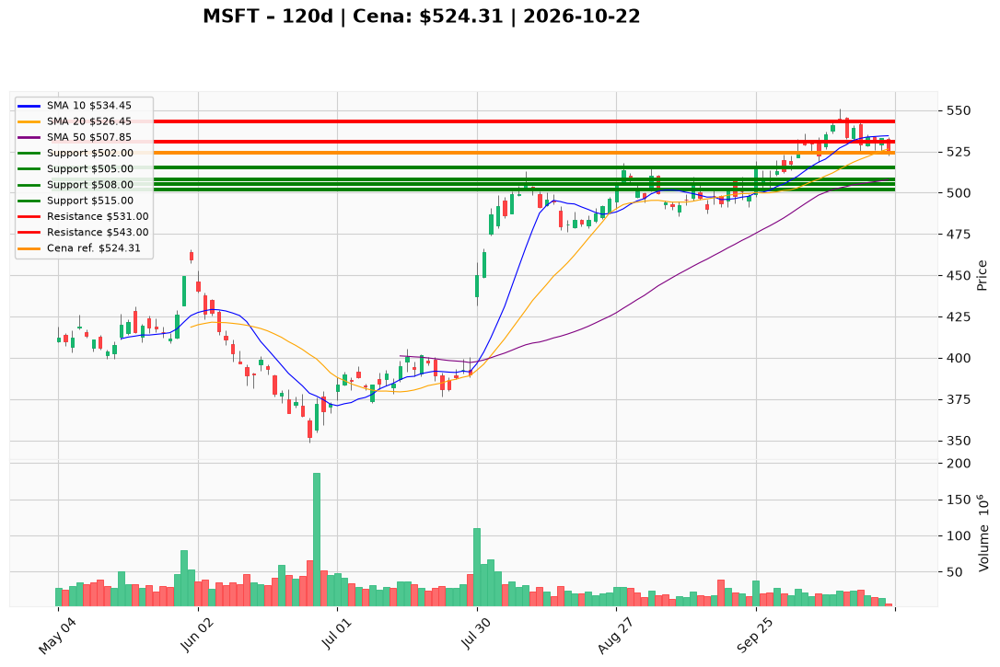

# MSFT — Ticket (2026-10-22)

**Werdykt:** WAIT  
**Horyzont:** pozycja (tygodnie–miesiące)  
**Cena ref.:** $524.31

| | Poziom | Uwagi |
|---|--------|------|
| **Wejście** | $511.00 | limit buy w strefie $508–515 (50 SMA + dolna BB); nie market przy ~$524 |
| **Stop-loss** | $502.00 | hard invalidation (~2× ATR od wejścia); zamknięcie dzienne poniżej $505 też unieważnia dip |
| **TP1** | $531.00 | zrealizuj ~50% — reclaim 10 EMA / VWMA (~$530–533) |
| **TP2** | $543.00 | reszta — swing high / sufit $540–545 |

**Sizing:** ryzyko **0,75–1,0%** kapitału na stop ($511→$502); start **~1–1,25%** gross (max **~2%** do potwierdzenia naprawy trendu przy TP1)  
**Warunek aktywacji:** wypełnienie limitu **$511** w paśmie wsparcia **$508–515**; alternatywa (nie domyślna): zamknięcie dzienne **powyżej $530**  
**Unieważnienie:** stop **$502** lub zamknięcie dzienne **< $505**; bez dokładania, jeśli MACD histogram robi nowe dołki w strefie wejścia

**Dlaczego (1–2 zdania):** PM **Overweight** przy silnych fundamentach Q2 i trendzie powyżej 200 SMA, ale wycena ~29× i słaby momentum (MACD −1,71) uzasadniają wejście regułowe na pullbacku, nie chase przy ostatniej cenie.

**WERDYKT KOŃCOWY:** WAIT na limit **$511**; po fill traktuj jak plan BUY z obowiązkowym de-riskiem na TP1.

