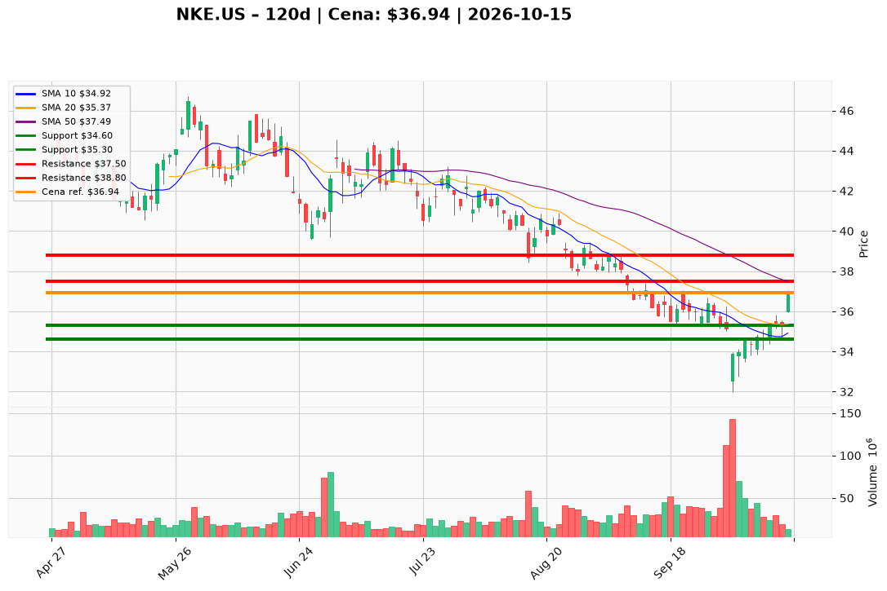

# NKE.US — Ticket (2026-10-15)

**Werdykt:** WAIT
**Horyzont:** swing (dni–tygodnie)
**Cena ref.:** $36.94

| | Poziom | Uwagi |
|---|--------|------|
| **Wejście** | $35.40 | limit dopiero po utrzymaniu 35.30–35.50; nie kupuj 36.94 |
| **Stop-loss** | $34.60 | hard invalidation: zamknięcie dnia pod VWMA (~34.61) i dołkiem z 2026-10-14 |
| **TP1** | $37.50 | zrealizuj ~50% (góra strefy 37.00–37.50 i SMA 50) |
| **TP2** | $38.80 | reszta / trailing; tylko po zamknięciu dnia nad SMA 50 (~37.49) przy wolumenie ≥ ~19 mln |

**Sizing:** max 0,50% kapitału; przy wejściu $35.40 i SL $34.60 ryzyko ≈ $0.80/akcję. Przy cenie ref. nowe ryzyko = 0%.
**Warunek aktywacji** (jeśli WAIT): korekta, która utrzyma 35.30–35.50 na zamknięciu, histogram MACD nadal dodatni, RSI powyżej ~45. To nie jest zlecenie oczekujące i nie jest dokupieniem w paśmie 35.50–37.00.
**Unieważnienie:** dzienne zamknięcie poniżej $34.60. Plan odbicia pada też przy zejściu marży brutto w stronę 40%, kolejnym kwartale gotówki poniżej $500 mln albo cięciu dywidendy.

**Dlaczego (1–2 zdania):** PM i trader zostawiają Hold: wycena przy ~$37 jest zbliżona do fair (forward EPS $1.66 × 22.3, trailing $2.08 × 17.8, EV/EBITDA ~11–12×), ale 36.94 to rozciągnięte odbicie (Bollinger %b ~0.98, MACD −0.54, wolumen 13.9 mln vs mediana ~19 mln). Do SMA 50 (37.49) jest ~$0.55, a do unieważnienia 34.60 ~$2.34 — słabe R/R na tym wydruku.

**WERDYKT KOŃCOWY:** WAIT — nie otwieraj pozycji przy $36.94; jedyne wejście swing to utrzymanie 35.30–35.50, cap 0,50% kapitału, SL $34.60, TP1 $37.50, TP2 $38.80.

