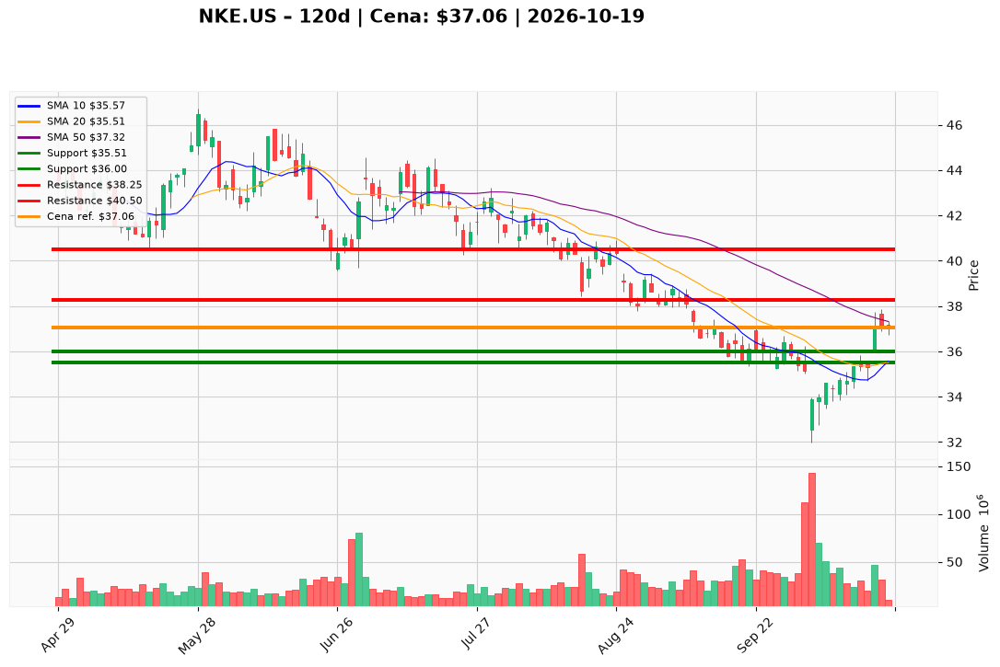

# NKE.US — Ticket (2026-10-19)

**Werdykt:** WAIT
**Horyzont:** swing (dni–tygodnie)
**Cena ref.:** $37.06

| | Poziom | Uwagi |
|---|--------|------|
| **Wejście** | $35.75 | limit w strefie $35.50–$36.00 (10 EMA ~$36.00); alternatywa: zamknięcie dnia > $38.00 przy wolumenie ≥30 mln i utrzymanie nad 10 EMA następnej sesji — nie kupuj przy $37.06 |
| **Stop-loss** | $35.51 | hard invalidation: zamknięcie dnia pod środkiem Bollingera (struktura odbicia padła) |
| **TP1** | $38.25 | zrealizuj ~50% (strefa $37.50–$38.00 / rozszerzenie SMA 50) |
| **TP2** | $40.50 | reszta / trailing; cel w strefie $40–$42 przy potwierdzeniu utrzymania SMA 50 |

**Sizing:** przy wypełnionym wejściu (~$35.75 lub po breakout >$38) ryzyko ~0,75–1,0% kapitału; budżet na akcję ~1,5× ATR (~$1.65) od wejścia. Przy cenie ref. nowe pełne ryzyko = 0%.
**Warunek aktywacji** (jeśli WAIT): pullback z limitem $35.75 albo wolumenowy breakout powyżej $38 — bez dodawania pełnego rozmiaru w opór (SMA 50 ~$37.32, górne Bollinger ~$37.47).
**Unieważnienie:** dzienne zamknięcie poniżej $35.51 z histogramem MACD na minusie i RSI <50 kończy tezę swingowego odbicia; głębszy floor ryzyka ~$33.55 przy przełamaniu dolnego pasma.

**Dlaczego (1–2 zdania):** PM i trader utrzymują Hold na istniejącej ekspozycji z strefy $32–$35: Q4 FY26 wspiera retencję (marża ~49,2% r/r, EPS $0.72), ale przy ~$37 to relief rally w opór bez potwierdzenia wolumenu; flat revenue, forward EPS ~$1.60 vs TTM ~$2.08 i zapasy ~$7.5B limitują gonienie spotu.

**WERDYKT KOŃCOWY:** WAIT — nie otwieraj pełnej pozycji przy $37.06; wejście tylko na skryptowanym pullbacku ($35.75) lub breakout >$38, SL $35.51, TP1 $38.25, TP2 $40.50.

