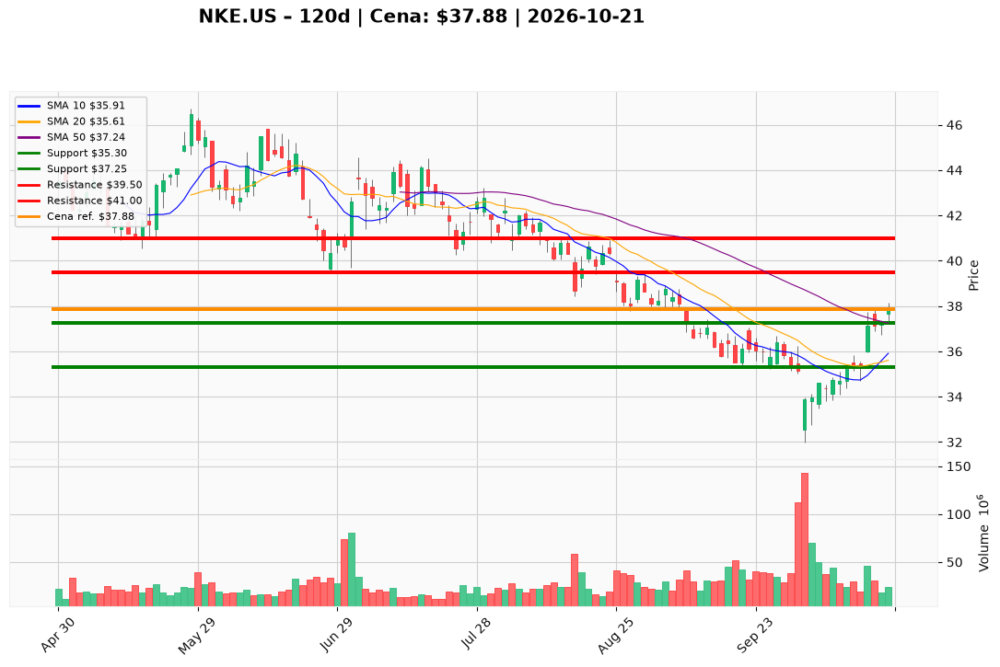

# NKE.US — Ticket (2026-10-21)

**Werdykt:** WAIT  
**Horyzont:** pozycja (tygodnie–miesiące)  
**Cena ref.:** $37.88

| | Poziom | Uwagi |
|---|--------|------|
| **Wejście** | $36.75–$37.25 | limit na pullback (50 SMA, macdh > 0) **lub** market po zamknięciu dziennym > $38.00 przy wolumenie ≥ ~30M |
| **Stop-loss** | $35.30 | hard invalidation — zamknięcie dzienne poniżej pivotu 14 paź |
| **TP1** | $39.50 | zrealizuj ~50% (opór wrz / strefa kongestii) |
| **TP2** | $41.00 | reszta / trailing (strefa wcześniejszego breakdownu) |

**Sizing:** 0,5–1,0% kapitału na transzę po potwierdzeniu triggera; R ≈ 1:1,5–2,0 od wejścia ~$37 do SL $35,30  
**Warunek aktywacji:** Nie kupuj na bieżącej cenie — cena przy górnej oporze Bollingera ($37,85–$38,15) bez potwierdzenia wolumenem (~24M vs ~30M).  
**Unieważnienie:** Zamknięcie dzienne < $35,30; odrzucenie $37,85–$38,15 z RSI spadającym z >60 i ujemny MACD histogram.

**Dlaczego (1–2 zdania):** PM i Trader zgodnie: Hold — jakość bilansu i odzysk 50 SMA, ale ~19% poniżej 200 SMA, forward P/E ~23,7 i brak breakoutu wolumenowego; nowe ryzyko dopiero po pullbacku lub zamknięciu > $38.

**WERDYKT KOŃCOWY:** WAIT — nie otwieraj pozycji na spot; aktywuj plan po triggerze technicznym.

