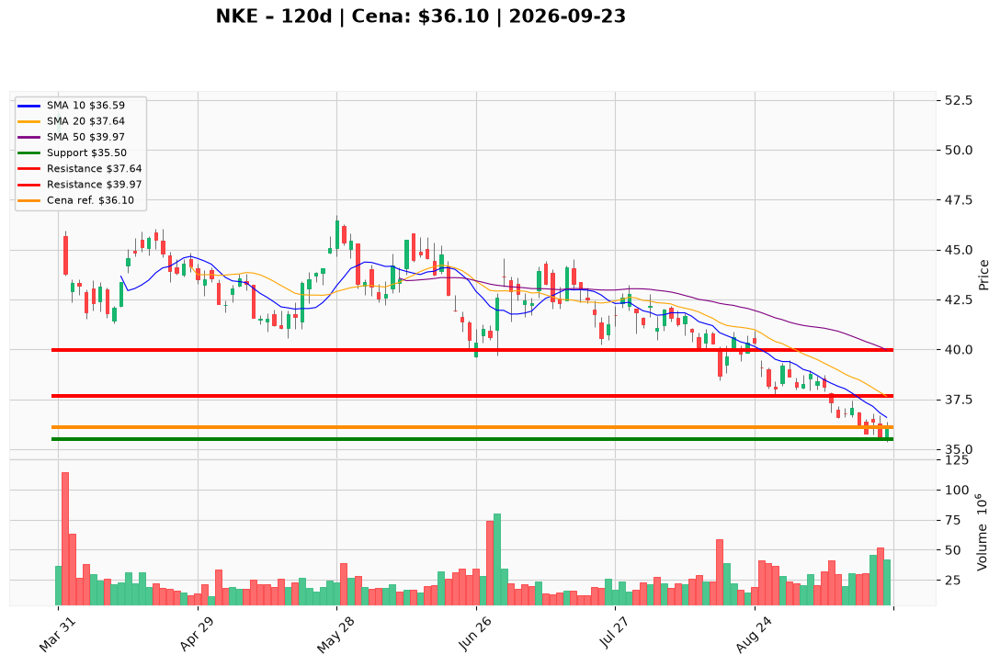

# NKE — Ticket (2026-09-23)

**Werdykt:** WAIT
**Horyzont:** pozycja (tygodnie–miesiące)
**Cena ref.:** $36.10

| | Poziom | Uwagi |
|---|--------|------|
| **Wejście** | $36.61+ | limit po zamknięciu dziennym powyżej 10 EMA z wolumenem >35M; nie kupuj na rynku przy $36.10 |
| **Stop-loss** | $35.50 | hard invalidation pod dołkiem z 18.09; ryzyko przedłużenia do $34.50–$35.05 |
| **TP1** | $37.64 | zrealizuj ~50% przy odbiciu do środka Bollingera |
| **TP2** | $39.97 | reszta w strefie SMA 50 — historyczna strefa odrzucenia |

**Sizing:** 0% kapitału teraz; po aktywacji max ~0,5–1,0% ryzyka portfela (R ≈ 1,6% do SL)
**Warunek aktywacji:** Zamknięcie dzienne >$36.61 przy wolumenie >35M i RSI >40 — lub ponowna ocena po raporcie Q1 (1.10) przy marży brutto ≥45% i stabilnych zapasach
**Unieważnienie:** Zamknięcie dzienne <$35.50, lub Q1 z marżą brutto <45% i rosnącą presją promocyjną — ścieżka w dół ku $34.00

**Dlaczego (1–2 zdania):** PM i Trader zgodnie: nie otwieraj nowej pozycji na rynku 8 dni przed raportem Q1 (1.10) — wykres strukturalnie słaby (death cross, -26,6% pod SMA 200), a historyczne luki po wynikach sięgały -10,5% do -15,6%. Q4 pokazał infleksję marży (49,1%), ale trwałość Q1 na trudniejszej bazie pozostaje nieudowodniona.

**WERDYKT KOŃCOWY:** WAIT — nie gonij rynku; czekaj na potwierdzenie techniczne lub klarowny sygnał po wynikach.

