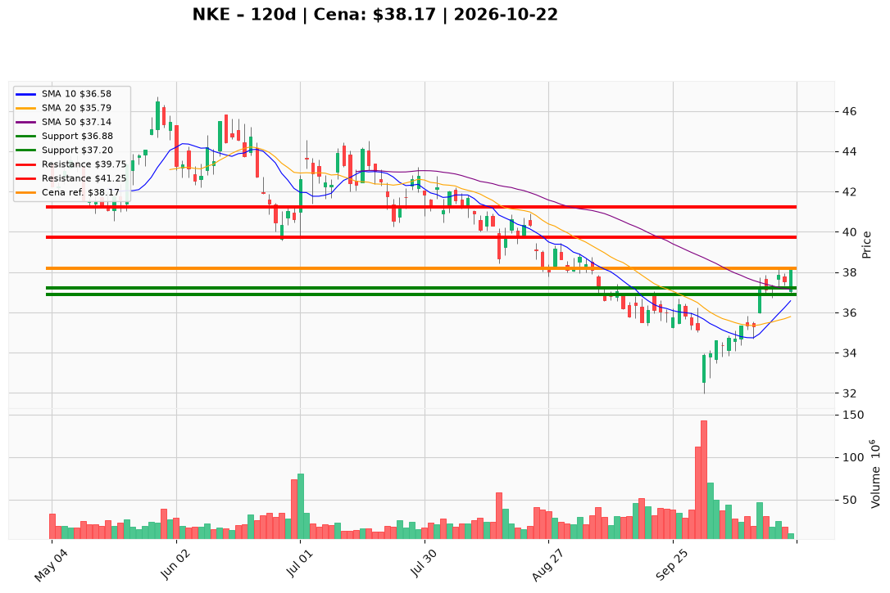

# NKE — Ticket (2026-10-22)

**Werdykt:** WAIT
**Horyzont:** pozycja (tygodnie–miesiące)
**Cena ref.:** $38.17

| | Poziom | Uwagi |
|---|--------|------|
| **Wejście** | $37.20 | limit na pullback do strefy SMA 50 (~$37.14); nie kupować market przy $38.17 przy górnej wstęgu Bollingera (~$38.43) |
| **Stop-loss** | $36.88 | hard invalidation — zamknięcie dziennie poniżej klastra SMA 50 / ~$37 i bufora 10 EMA |
| **TP1** | $39.75 | zrealizuj ~50% w półce $39.50–$40.00 |
| **TP2** | $41.25 | reszta w kongesti $40.00–$42.00; ~$46 (SMA 200) jako rozciągnięty sufit bez potwierdzenia przychodów |

**Sizing:** 2.0–2.5% kapitału na pełną nogę (dolny zakres księgi); ryzyko od wejścia do stopu max ~0.5% kapitału (~0.75R vs normalna pozycja) do czasu powrotu nagłówków Nike.
**Warunek aktywacji** (jeśli WAIT): wypełnienie limitu $37.20 przy RSI utrzymującym się ~52–58; breakout stop-limit $38.55 po potwierdzonym zamknięciu dziennym powyżej $38.43 — PM: nie uzbrajać breakoutu, dopóki feed newsów jest „ślepy” lub leadership nie zrewiduje scenariusza.
**Unieważnienie:** zamknięcie dziennie poniżej ~$37.00 na wolumenie z histogramem MACD w dół; narracja o cofnięciu marży FQ1’27 (gross poniżej ~45%).

**Dlaczego (1–2 zdania):** PM i Trader zbiegli się na Hold: po inflekcji marży FQ4 (~49% gross, $0.72 EPS) i poprawie momentum (MACD, reclaim SMA 50) nie ma sensu gonić ceny przy górnej wstęgu — przychody $10.97B są najsłabsze w czterech kwartałach, trend główny wciąż spadkowy (~17% pod SMA 200), a sentyment/news nie dają przewagi w tym przebiegu.

**WERDYKT KOŃCOWY:** WAIT — stań z boku przy wycenie, uzbrój tylko limit $37.20 z twardym SL $36.88 i planem TP $39.75 / $41.25.

