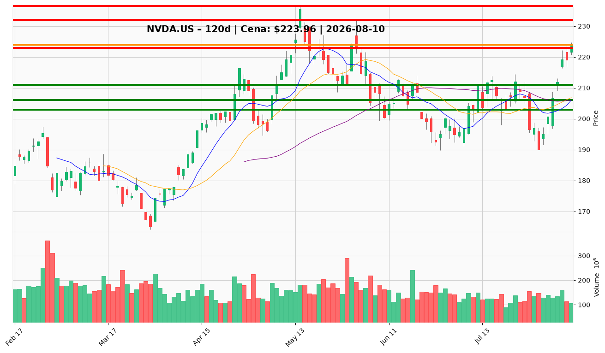

# NVDA.US — Ticket posiadacza (2026-08-10)

**Werdykt:** HOLD
**Horyzont:** swing (dni–tygodnie)
**Cena ref.:** $223.96

| | Poziom | Uwagi |
|---|--------|------|
| **Akcja teraz** | Trzymaj; realizuj 25% przy TP1 | Pozycja zapisana: wejście $209.92 (+6,7% niezrealiz.) |
| **Stop-loss** | $203.00 | twardy — poniżej 50 SMA i bazy lipiec–sierpień |
| **TP1** | $223.00 | redukcja 25% — cena dotarła do górnej wstęgi Bollingera |
| **TP2** | $232.00 | wyjście reszty — poprzedni szczyt konsolidacji |

**Sizing / skala:** Utrzymaj 75% pozycji po realizacji 25% przy $223–224. Po TP1: trailing stop na $210 (breakeven) na reszcie.
**Warunek dokupu:** Brak dokupu powyżej $220. Ewentualny dokup tylko przy pullbacku do $206–208 (retest 10-EMA / 50 SMA).
**Unieważnienie / pełne wyjście:** Zamknięcie dzienne poniżej $203.00 → wyjście z całej pozostałej pozycji.

**Dlaczego (1–2 zdania):** Odbicie V-shape potwierdzone przez crossover MACD i powrót powyżej 50 SMA; deal infrastrukturalny $5B (Lancium + Firmus) oraz fundamenty (marża 63%, forward P/E 17×) wspierają dalszy trend do $232. Cena jest przy górnej wstędze Bollingera ($224) — czas na zaplanowaną realizację 25% przy TP1, resztę prowadź z dyscypliną SL/TP.

**WERDYKT KOŃCOWY:** HOLD — realizuj 25% przy $223, trzymaj resztę z SL $203 i TP2 $232.

