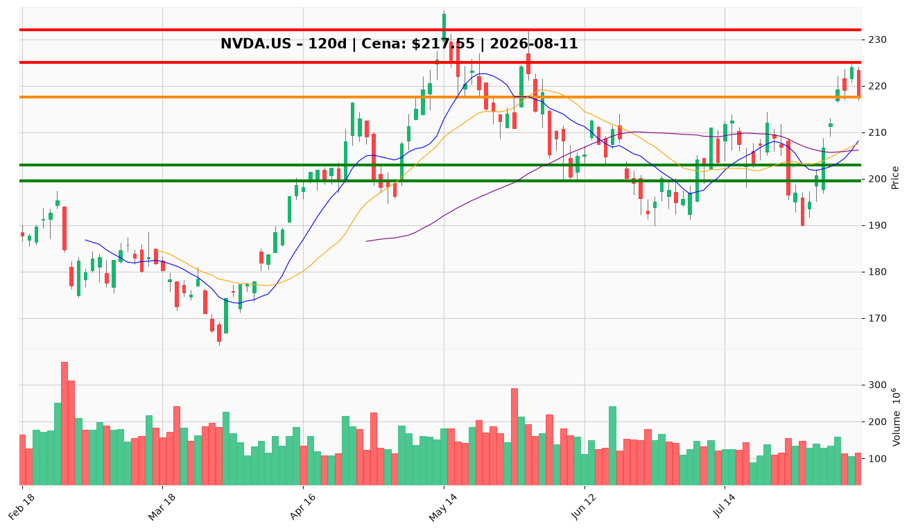

# NVDA.US — Ticket posiadacza (2026-08-11)

**Werdykt:** HOLD
**Horyzont:** swing (dni–tygodnie)
**Cena ref.:** $217.55
**Pozycja zapisana:** entry $209.92 / SL $203.00 / TP1 $223.00 / TP2 $232.00 (w zysku ~+3.6%)

| | Poziom | Uwagi |
|---|--------|------|
| **Akcja teraz** | trzymaj | bez dokupu @ market — czekaj na korektę |
| **Stop-loss** | $203.00 | twardy; poniżej półki 50-SMA/VWMA (~$206–207), nad 200-SMA ($194) |
| **TP1** | $225.00 | redukcja ~1/3 — szczyt 07.08 ($224.76) + górna wstęga Bollingera |
| **TP2** | $232.00 | wyjście reszty — strefa szczytu majowego $231–236.5 |

**Sizing / skala:** trzymaj pełną pozycję; przy TP1 sprzedaj ~1/3, reszta z trailingiem; dokup maks. +25% pozycji wyłącznie w strefie $208–212 (50-SMA/VWMA/10-EMA).
**Warunek dokupu (jeśli ADD):** korekta do $208–212 z obroną tej strefy — nie gonić ceny, nie dokupywać powyżej $212.5.
**Unieważnienie / pełne wyjście:** dzienne zamknięcie poniżej $199.50 → wyjście całości @ market; poniżej $190 (baza lipcowa) teza swingowa martwa.

**Dlaczego (1–2 zdania):** Fundamenty hiperwzrostowe (+85% r/r przychodu, FCF $48.6 mld/kwartał, fwd P/E ~16.9) wsparte programem $500 mld na AI-infrastrukturę, a trend powyżej 200-SMA z rosnącym MACD — ale odrzucenie przy $224.8 i jednostronna sprzedaż insiderów wymaga dyscypliny: redukcja przy TP1, dokup tylko na korekcie.

**WERDYKT KOŃCOWY:** TRZYMAJ (HOLD) z planem — redukcja 1/3 @ $225, reszta z trailingiem do $232, twardy stop $203.

