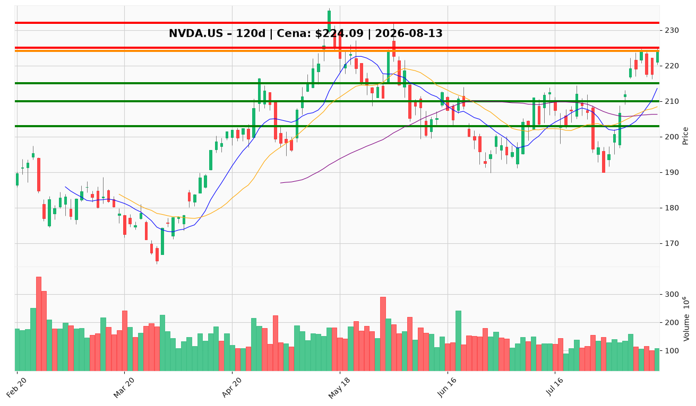

# NVDA.US — Ticket posiadacza (2026-08-13)

**Werdykt:** HOLD
**Horyzont:** swing (dni–tygodnie)
**Cena ref.:** $224.09

| | Poziom | Uwagi |
|---|--------|------|
| **Akcja teraz** | Trzymaj | Brak dokupu powyżej $225; pozycja zapisana @ $209.92 (+6,7%) |
| **Stop-loss** | $203.00 | Twardy — poniżej 50 SMA i strefy konsolidacji lipca |
| **TP1** | $225.00 | Redukcja 30–40% pozycji przy górnej wstędze Bollingera |
| **TP2** | $232.00 | Wyjście z reszty w okolicy podejścia do ATH ($236.54) |

**Sizing / skala:** Utrzymaj obecną ekspozycję. Po realizacji TP1 przesuń SL reszty na breakeven ($210). Nie dokupuj przy cenie >$225.

**Warunek dokupu** (jeśli ADD): Pullback do $210–$215 (10 EMA / VWMA) z potwierdzeniem wolumenem — nie dotyczy obecnej sytuacji.

**Unieważnienie / pełne wyjście:** Dzienne zamknięcie poniżej $203.00.

**Dlaczego (1–2 zdania):** Fundamenty (PEG 0,60, marża 63%) i momentum (MACD bullish, cena powyżej SMA) wspierają trzymanie, ale cena przy oporze $225 po 18% rajdzie z lipca — lepszy risk/reward to zarządzanie TP1 niż dokup na szczycie.

**WERDYKT KOŃCOWY:** HOLD — trzymaj pozycję @ $209.92, realizuj częściowo przy $225, resztę do $232 ze SL $203.

