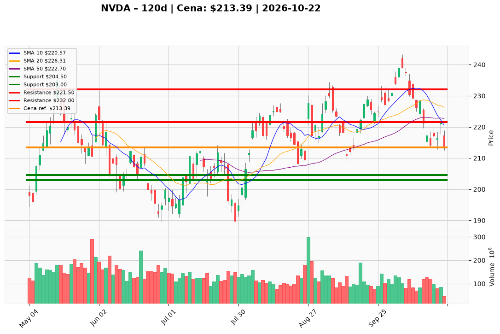

# NVDA — Ticket (2026-10-22)

**Werdykt:** WAIT
**Horyzont:** swing (dni–tygodnie)
**Cena ref.:** $213.39

| | Poziom | Uwagi |
|---|--------|------|
| **Wejście** | $208.00–$210.00 | limit (opcjonalna jedna transza) **lub** aktywacja po zamknięciu dziennego **> $223** z poprawą momentum; **nie** kupuj na rynku przy $213.39 |
| **Stop-loss** | $204.50 | twarda invalidacja taktyczna (~1,5× ATR); strukturalny cut przy zamknięciu dziennego **< $200** (wolumen pełnej sesji > ~100M) |
| **TP1** | $221.50 | zrealizuj ~50% w strefie 10 EMA / 50 SMA ($220–$223) |
| **TP2** | $232.00 | reszta po odzyskaniu ~$226 (VWMA / środek Bollingera) w kierunku $230–$235 |

**Sizing:** Brak agresywnego startu przy cenie ref. Opcjonalna pojedyncza transza **0,25%** kapitału w strefie $208–$210 (max **0,5%** łącznie przy podziale), pod warunkiem utrzymania 200 SMA (~$203) na zamknięciu dziennym. Pełniejsze wejście tylko po **> $223** (MACD histogram bez nowych dołków, RSI > 45) — ryzyko ~0,5R przy ATR ~$6,15 do SL $204,50.

**Warunek aktywacji:** (1) Limit $208–$210 przy trzymanym 200 SMA; **lub** (2) zamknięcie dzienne **> $223** z stabilizacją MACD i RSI > 45 — wtedy dopiero rozważ normalny sizing.

**Unieważnienie:** Zamknięcie dzienne **< $200** na podwyższonym wolumenie; lub trwałe przełamanie 200 SMA (~$203) z 50 SMA w dół bez poprawy OCF/należności w kolejnym raporcie.

**Dlaczego (1–2 zdania):** PM i Trader: **Hold** — fundamenty nadal wyjątkowe (przychody ~+106% r/r, fwd P/E ~13,4), ale luka OCF/FCF i należności +$22,4B QoQ oraz technika pod 10 EMA/50 SMA (~$223) z pogarszającym się MACD po nieudanym odbiciu 2026-10-22 nie uzasadniają pogoni za ceną. Brak obserwowanego sentymentu/newsów NVDA = ryzyko luk bez narracji.

**WERDYKT KOŃCOWY:** WAIT — nie otwieraj pozycji na rynku przy $213,39; opcjonalnie 0,25% limit w $208–$210 lub pełniejsze wejście po zamknięciu **> $223**; SL $204,50 (hard **< $200**).

