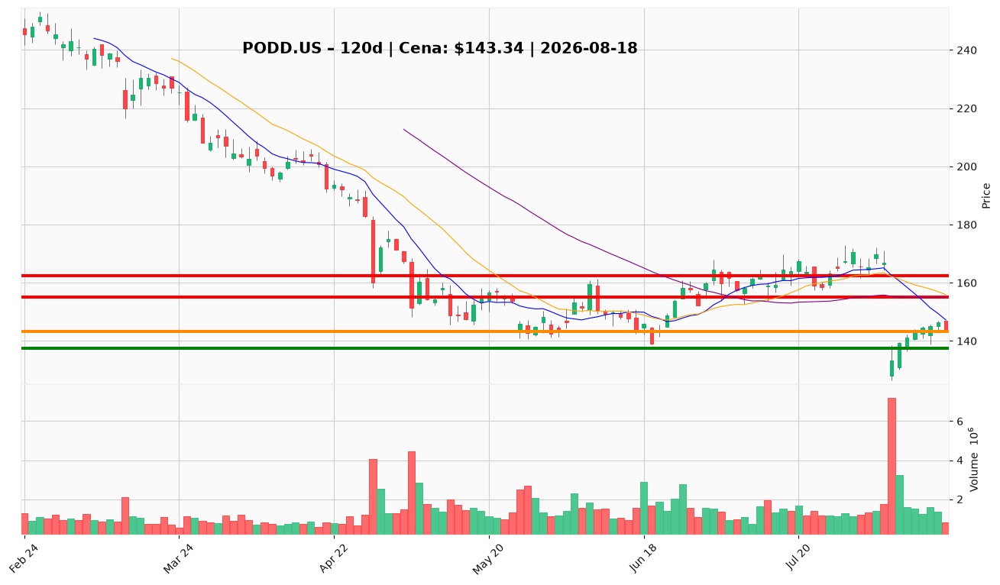

# PODD.US — Ticket posiadacza (2026-08-18)

**Werdykt:** REDUCE
**Horyzont:** swing (dni–tygodnie)
**Cena ref.:** $143.34

| | Poziom | Uwagi |
|---|--------|------|
| **Akcja teraz** | Redukcja 25–33% przy rajdzie | Sprzedaj część w strefie $147–$155; pozycja zapisana bez ceny wejścia |
| **Stop-loss** | $137.50 | Twardy — poniżej klastra wsparcia $138–$131 (swing low 12.08 + dolna wstęga Bollingera) |
| **TP1** | $155.00 | Redukcja części przy 50 SMA / środku Bollingera (~+8,7%) |
| **TP2** | $162.50 | Wyjście z reszty w strefie konsolidacji sprzed luki (~+13,4%) |

**Sizing / skala:** Brak nowej alokacji (0%). Ogranicz ekspozycję do ≤2% kapitału portfela; przy rajdzie w $147–$155 zredukuj 25–33% pozycji. Ryzyko do stopu max 0,5% kapitału (~4,1% ruchu przeciwnego).

**Warunek dokupu** (jeśli ADD): Nie dotyczy — PM Underweight, zero nowych wejść do zamknięcia dziennego powyżej $148 przy wolumenie ≥2M i RSI >50.

**Unieważnienie / pełne wyjście:** Dzienne zamknięcie poniżej $137.50 otwiera ścieżkę do $126.40 (52-tyg. dołek) — wyjdź z reszty pozycji.

**Dlaczego (1–2 zdania):** Fundamenty Omnipod pozostają solidne (Q2 +23,5% przych., ~70% marży), ale luka z 5.08 po cięciu guidance i ryzyku retencji T2D zostawiła cenę pod pełnym stosem SMA; odbicie zatrzymało się przy $146,44, RSI nie odzyskał 50. PM Underweight — rajdy w opór to strefa trimu, nie dokupu.

**WERDYKT KOŃCOWY:** REDUCE — trzymaj resztę ze SL $137.50, redukuj 25–33% przy $147–$155, skaluj wyjście przy $155 / $162.50.

