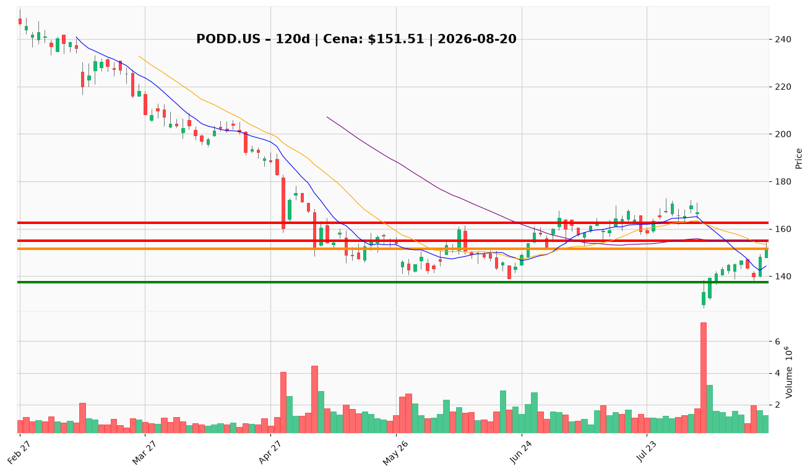

# PODD.US — Ticket posiadacza (2026-08-20)

**Werdykt:** REDUCE
**Horyzont:** swing (dni–tygodnie)
**Cena ref.:** $151.51

| | Poziom | Uwagi |
|---|--------|------|
| **Akcja teraz** | Redukcja 25% @ market | Cena w strefie trimu $147–$155; pozycja zapisana: wejście $145.00 |
| **Stop-loss** | $137.50 | Twardy — poniżej dołka 17.08 ($138.28) i trajektorii dolnej wstęgi Bollingera |
| **TP1** | $155.00 | Kolejna redukcja 15–20% przy 50 SMA / środku wstęgi (~+6,9% od wejścia) |
| **TP2** | $162.50 | Wyjście z reszty w strefie konsolidacji sprzed luki (~+12,1%) |

**Sizing / skala:** Brak nowej alokacji (0%). Zredukuj 25% pozycji teraz przy $151.51 (+4,5% od wejścia $145.00). Trzymaj 75% ze SL $137.50. Ryzyko do stopu max 0,5% kapitału (~9,2% ruchu od ceny bieżącej).

**Warunek dokupu** (jeśli ADD): Nie dotyczy — PM Underweight. Ewentualny add tylko po zamknięciu dziennym powyżej $155 przy wolumenie ≥1,5M i RSI >50.

**Unieważnienie / pełne wyjście:** Dzienne zamknięcie poniżej $137.50 otwiera ścieżkę do $126.40 (52-tyg. dołek) — wyjdź z reszty pozycji.

**Dlaczego (1–2 zdania):** Odbicie z $126.40 do $151.51 potwierdza absorpcję po luce, ale wolumen spada (1,3M vs 7,2M w dniu luki), a test $155.17 z 19.08 nie przebił 50 SMA ($154.75). Fundamenty Omnipod pozostają solidne (Q2 +23,5%, marża ~70%), lecz ryzyko retencji T2D i cięcie guidance utrzymują presję na wycenie — rajdy w opór to strefa trimu, nie dokupu.

**WERDYKT KOŃCOWY:** REDUCE — zredukuj 25% teraz przy $151.51, trzymaj resztę ze SL $137.50, skaluj wyjście przy $155 / $162.50.

