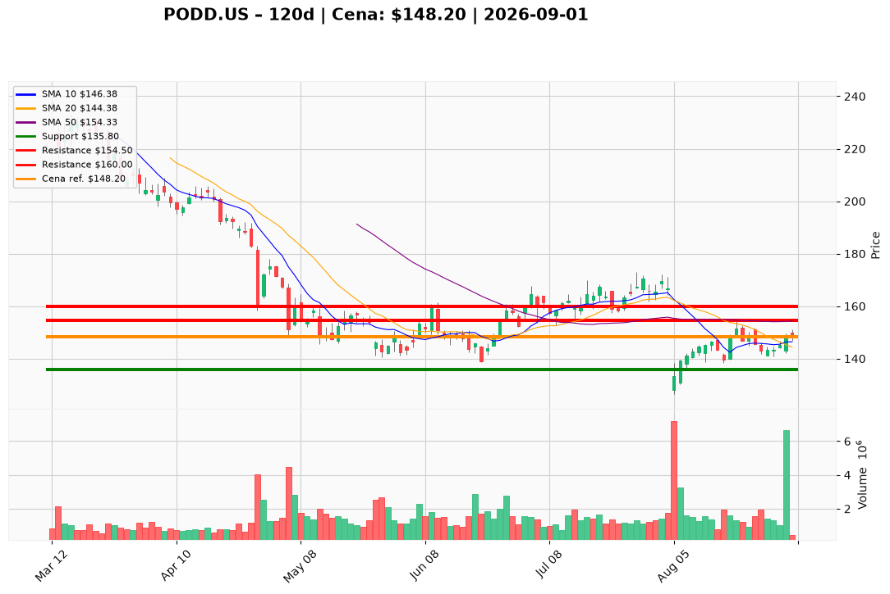

# PODD.US — Ticket posiadacza (2026-09-01)

**Werdykt:** HOLD
**Horyzont:** swing (dni–tygodnie)
**Cena ref.:** $148.20
**Pozycja zapisana:** wejście $145.00 → niezrealizowany zysk **+2,2%** (+$3.20/akcję)

| | Poziom | Uwagi |
|---|--------|------|
| **Akcja teraz** | Trzymaj | Bez dokupów na słabości; ewentualna redukcja **20–25%** przy wzroście do strefy $152–$155 bez katalizatora T2D |
| **Stop-loss** | $135.80 | twardy — poniżej dolnej wstęgi Bollingera / 2× ATR |
| **TP1** | $154.50 | redukcja części (50 SMA / opór) |
| **TP2** | $160.00 | wyjście reszty przy utrzymaniu momentum |

**Sizing / skala:** Utrzymaj obecną alokację; nie dokupuj. Przy odbiciu do $152–$155 odłóż 20–25% pozycji. Kapitał z redukcji nie reinwestuj, dopóki brak zamknięcia powyżej $154.50 na podwyższonym wolumenie lub poprawy retencji T2D.

**Warunek dokupu** (jeśli ADD): Nie dotyczy — brak dokupów dla obecnych posiadaczy do czasu potwierdzonego breakoutu powyżej $154.50.

**Unieważnienie / pełne wyjście:** Zamknięcie poniżej $136 na rosnącym wolumenie, gap przez stop na negatywnych newsach T2D/konkurencji (Medtronic MiniMed) lub utrata wsparcia $141 przy retescie.

**Dlaczego (1–2 zdania):** Fundamenty pozostają solidne (Q2 +23,5% YoY, marża brutto 71%, FWD P/E 19,2x), ale EPS jest płaski, SG&A rośnie szybciej niż przychody, a technicznie akcja konsoliduje się w $141–$149 poniżej 200 SMA — brak przewagi na agresywne dokupy ani na pełne wyjście.

**WERDYKT KOŃCOWY:** HOLD — utrzymaj pozycję, zarządzaj SL/TP, redukuj częściowo w strefie oporu bez nowych wejść.

