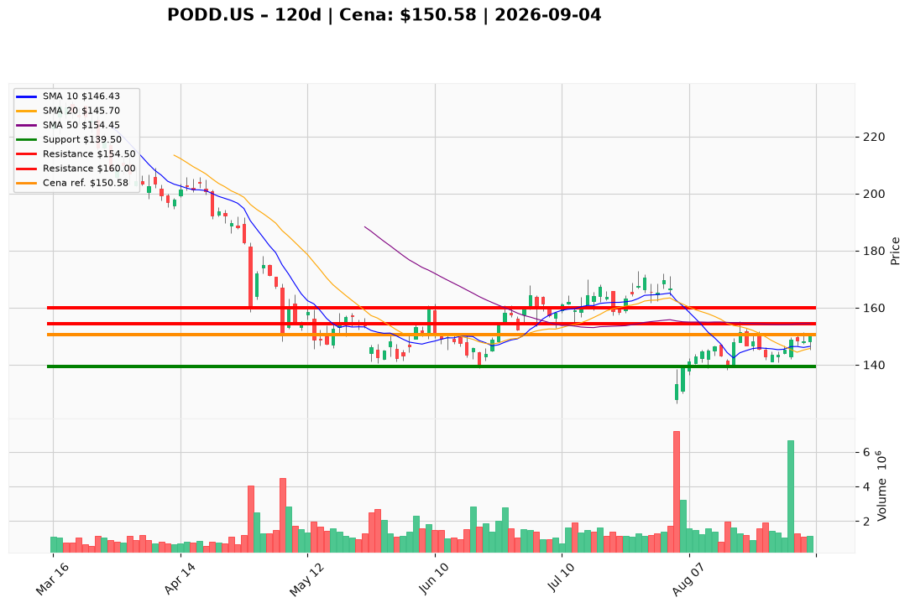

# PODD.US — Ticket posiadacza (2026-09-04)

**Werdykt:** HOLD
**Horyzont:** swing (dni–tygodnie)
**Cena ref.:** $150.58

| | Poziom | Uwagi |
|---|--------|------|
| **Akcja teraz** | Trzymaj | Bez dokupu — czekaj na przebicie $154.50 |
| **Stop-loss** | $139.50 | twardy — poniżej dolnej wstęgi Bollingera |
| **TP1** | $154.50 | redukcja 30–40% przy teście SMA50 |
| **TP2** | $160.00 | wyjście reszty / trailing stop |

**Pozycja zapisana:** wejście $145.00 | P/L nier.: **+3.8%** ($+5.58/akcję)

**Sizing / skala:** utrzymaj obecną ekspozycję; nie dokupuj do potwierdzenia wybicia
**Warunek dokupu:** dzienne zamknięcie > $154.50 przy wolumenie > 1.5M
**Unieważnienie / pełne wyjście:** zamknięcie dzienne < $139.50 lub negatywny headline prawny/FDA

**Dlaczego (1–2 zdania):** Fundamenty Insulet pozostają silne (EPS rośnie, FCF dodatni, fwd P/E 19.5), a momentum krótkoterminowe się poprawia (MACD histogram dodatni, 3 wyższe dołki). Jednak pozycja wisi pod SMA50 ($154.50), a ryzyko prawne i konkurencja MiniMed ograniczają upside — dla posiadacza z zyskiem +3.8% optymalne jest trzymanie z zaostrzonym SL.

**WERDYKT KOŃCOWY:** HOLD — trzymaj pozycję, SL $139.50, realizuj częściowo przy $154.50 i $160.00; dokup dopiero po potwierdzonym wybiciu SMA50.

