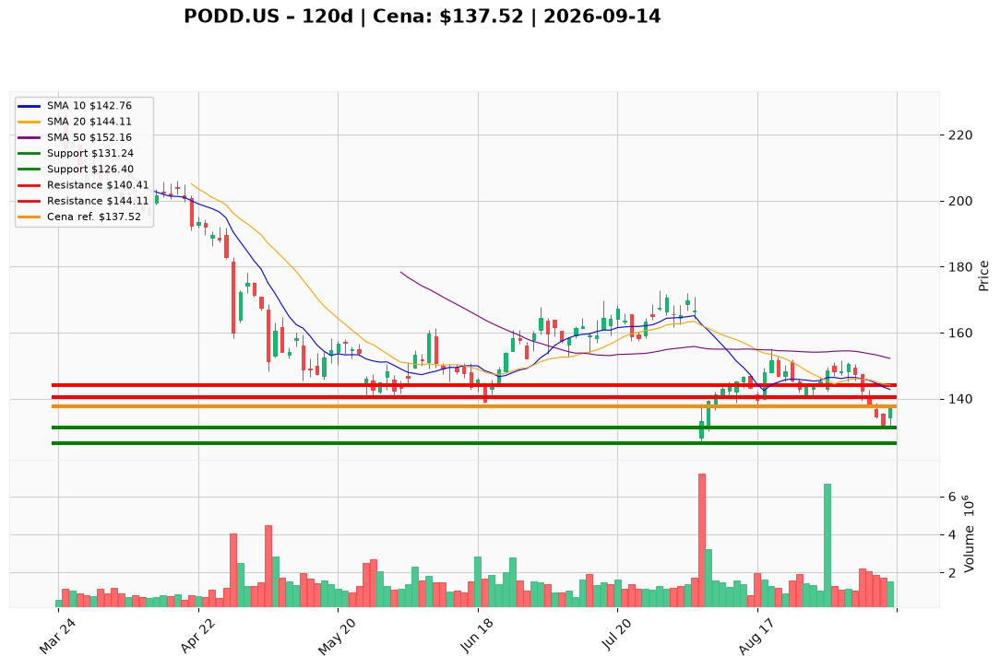

# PODD.US — Ticket posiadacza (2026-09-14)

**Werdykt:** REDUCE
**Horyzont:** swing (dni–tygodnie)
**Cena ref.:** $137.52

**Pozycja zapisana (PODD.US):** wejście **$145.00**; SL zapisany **$139.50**; TP1 zapisany **$154.50**; TP2 zapisany **$160.00**.  
P/L vs $137.52: **−$7.48 (−5,2%)**. Zapisany SL $139.50 jest już przebity.

| | Poziom | Uwagi |
|---|--------|------|
| **Akcja teraz** | Sprzedaj ~40% w bounce | limity $140.41–$144.11; nie dump @ market $137.52; bez dokupu |
| **Stop-loss** | **$131.24** | twardy — zamknięcie pod dołkiem 11.09 (PM; zastępuje przebity $139.50) |
| **TP1** | **$140.41** | redukcja części @ 10 EMA |
| **TP2** | **$144.11** | dalsza redukcja @ 20 SMA / VWMA ~$143.18; nie ciągnąć do $148–$152 |

**Sizing / skala:** ~40% pozycji (środek pasma 30–50% z Tradera); reszta na tyle mała, by zejście do $126.40 było irytacją, nie drugą tezą. Zero uśredniania.
**Warunek dokupu:** Brak — ADD zablokowany przy $137.52.
**Unieważnienie / pełne wyjście:** Zamknięcie pod $131.24 → twardy SL reszty. Zamknięcie pod $126.40 (dołek 5.08) → EXIT reszty, nie uśredniać. Plan REDUCE pada przy zamknięciu powyżej $140.41 z rosnącym wolumenem przez $143–$144.

**Dlaczego (1–2 zdania):** PM Sell: bounce 14.09 (+4,2% na 1,53M vs spike 6–7M) to mean-reversion w złamanej strukturze (cena 2,1% pod 10 EMA, 9,6% pod 50 SMA). Fundamenty żywe, dlatego trim ~40% w siłę, nie panika i nie dokup.

**WERDYKT KOŃCOWY:** **REDUCE** — sprzedaj ~40% zapisanej pozycji PODD.US (wejście $145.00; P/L −5,2%) w $140.41 / $144.11; reszta ze SL **$131.24**; bez dokupu. Zapisany SL $139.50 przebity; stare TP $154.50 / $160.00 odłożone.

