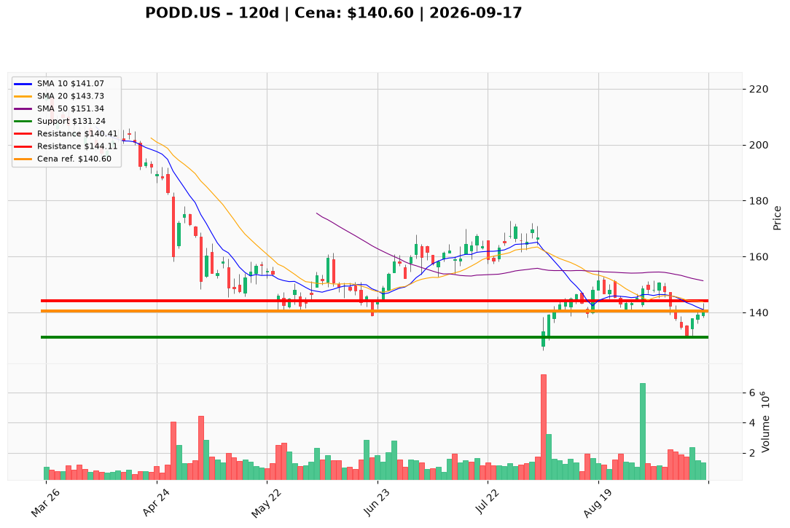

# PODD.US — Ticket posiadacza (2026-09-17)

**Werdykt:** REDUCE
**Horyzont:** swing (dni–tygodnie)
**Cena ref.:** $140.60

**Pozycja zapisana (PODD.US):** wejście **$145.00**; SL zapisany **$131.24**; TP1 zapisany **$140.41**; TP2 zapisany **$144.11**.  
P/L vs $140.60: **−$4.40 (−3,0%)**. Cena jest na TP1 — pierwszy poziom redukcji aktywny.

| | Poziom | Uwagi |
|---|--------|------|
| **Akcja teraz** | Sprzedaj ~35% w bounce | limity $140.41–$144.11; reszta ze SL $131.24; bez dokupu |
| **Stop-loss** | **$131.24** | twardy — zamknięcie pod dołkiem 11.09 |
| **TP1** | **$140.41** | redukcja części @ 10 EMA (osiągnięty) |
| **TP2** | **$144.11** | dalsza redukcja @ VWMA / strefa przed 50 SMA |

**Sizing / skala:** ~35% pozycji (PM Underweight; reszta ~65%); zero uśredniania do reclaim 50 SMA ($151.34).
**Warunek dokupu:** Brak — ADD zablokowany poniżej $151.34 z wolumenem.
**Unieważnienie / pełne wyjście:** Zamknięcie pod $131.24 → twardy SL reszty. Zamknięcie pod $126.40 (52w low) → EXIT reszty. Plan REDUCE pada przy zamknięciu powyżej $144.11 z rosnącym wolumenem przez $151.

**Dlaczego (1–2 zdania):** PM Underweight: odbicie do $140.60 (+6,6% od dołka $131.24) to mean-reversion w złamanej strukturze (cena 7% pod 50 SMA, 31% pod 200 SMA). Fundamenty żywe (fwd P/E ~18, ROE 26%), ale nagłówek Beta Bionics FDA wymusza trim w siłę, nie dokup.

**WERDYKT KOŃCOWY:** **REDUCE** — sprzedaj ~35% zapisanej pozycji PODD.US (wejście $145.00; P/L −3,0%) w $140.41 / $144.11; reszta ze SL **$131.24**; bez dokupu do reclaim $151.34.

