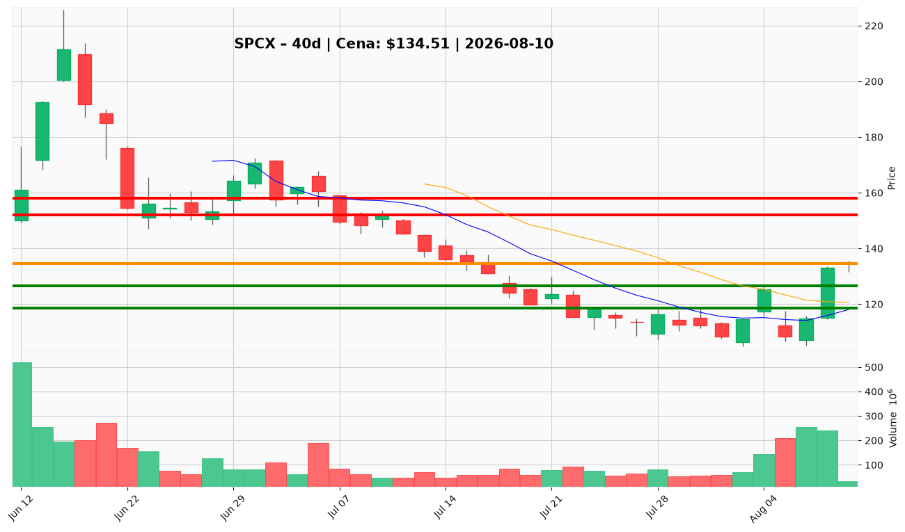

# SPCX — Ticket (2026-08-10)

**Werdykt:** WAIT
**Horyzont:** swing (dni–tygodnie)
**Cena ref.:** $134.51

| | Poziom | Uwagi |
|---|--------|------|
| **Wejście** | $126.50 / $142.50+ | limit na pullback do wsparcia $125–128; alternatywnie breakout przy dziennym zamknięciu powyżej $142.50 (50 SMA) |
| **Stop-loss** | $118.50 | hard invalidation poniżej $119 (10 EMA / VWMA) |
| **TP1** | $152.00 | zrealizuj ~50% — strefa wcześniejszego załamania po przebiciu $142 |
| **TP2** | $158.00 | reszta / trailing — półka konsolidacji przy $160 |

**Sizing:** 0,5% kapitału (połowa standardowego ryzyka R); przy ATR ~$10,46 rozmiar tak, by strata $16 (wejście $126,50 → SL $118,50) = 0,5% equity
**Warunek aktywacji:** Nie wchodź po bieżącej cenie $134,51 — aktywuj limit buy przy $126,50 lub breakout buy po dziennym zamknięciu >$142,50
**Unieważnienie:** Dzienne zamknięcie poniżej $118,50; lub odrzucenie oporu $139–142 z RSI <50 i kurczącym się histogramem MACD (powrót w kierunku $108–115)

**Dlaczego (1–2 zdania):** Q2 przyniosło realną poprawę fundamentów (przychody +92% r/r, marża brutto 55,3%, lock-up 911M akcji bez masowej sprzedaży insiderów), ale cena siedzi w górnej połowie zakresu $125–140, 3–6% poniżej oporu $139–142, w średnioterminowym spadku z $211 — PM i Trader: nie gonić rynku, czekać na zdefiniowany setup.

**WERDYKT KOŃCOWY:** CZEKAJ — nie otwieraj pozycji po $134,51; wejście tylko na pullback ($126,50) lub potwierdzonym breakoutie (>$142,50).

