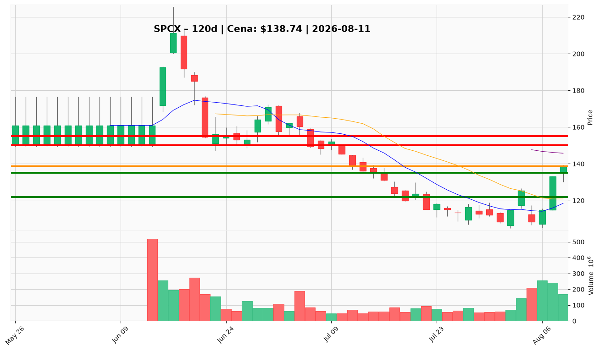

# SPCX — Ticket (2026-08-11)

**Werdykt:** WAIT
**Horyzont:** swing (dni–tygodnie)
**Cena ref.:** $138.74

| | Poziom | Uwagi |
|---|--------|------|
| **Wejście** | $142.00 | limit po potwierdzeniu: dzienne zamknięcie > $142 + utrzymanie następnej sesji > $141.50, wolumen ≥80M; alternatywa: pullback konstruktwny 122–125 |
| **Stop-loss** | $122.00 | hard invalidation (poniżej 10 EMA); przy CPI/unlock — $115.00 |
| **TP1** | $150.00 | zrealizuj ~50% |
| **TP2** | $155.00 | reszta / trailing; $160 tylko przy ekspansji wolumenu |

**Sizing:** Nie wchodź na rynku przy $138.74. Po triggerze $142: ryzyko ≤1% kapitału na pozycję (1R). Przy dźwigni 1:5 odległość wejście–SL ~$20 (~14%) oznacza ~70% straty na depozytu przy pełnym nominale — utrzymaj margin ~0,7–1,0% kapitału (nominalna ekspozycja ~3,5–5%), czyli efektive ~0,15–0,2R przy 5x. Nie dodawaj przy obecnej cenie.
**Warunek aktywacji:** CLOSE > $142 + hold > $141.50 następna sesja, vol ≥80M; lub odbicie z 122–125 z potwierdzeniem struktury.
**Unieważnienie:** Dzienne zamknięcie < $135 lub odrzucenie 141,97–142 na rosnącym wolumenie → plan off, ryzyko powrotu do 108–110.

**Dlaczego (1–2 zdania):** PM i Trader: HOLD bez dodawania — odbicie +21% w tygodniu przy spadającej 50 SMA (141,97), górna Bollinger i ~75x forward P/E; fundamenty Q2 silne (revenue +92%, marża 55,3%), ale retail sprzedaje rally i CPI/unlock nad głową. Nowy kapitał tylko po breakout $142 lub pullback 122–125.

**WERDYKT KOŃCOWY:** WAIT — nie inicjuj longa na $138,74; czekaj na $142+ z wolumenem lub korektę 122–125.

