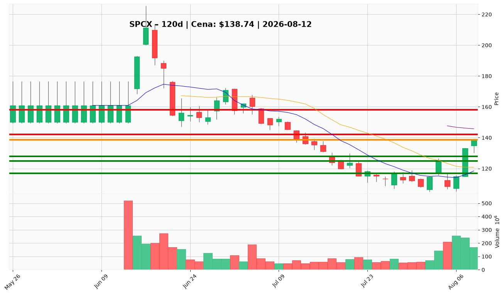

# SPCX — Ticket (2026-08-12)

**Werdykt:** WAIT
**Horyzont:** swing (dni–tygodnie)
**Cena ref.:** $138.74

| | Poziom | Uwagi |
|---|--------|------|
| **Wejście** | $125–$128 / $142+ | nie kupuj na $138,74 — pullback do pivotu 125–128 (limit) lub dzienne zamknięcie > $142 z wolumenem |
| **Stop-loss** | $117.00 | hard invalidation (2× ATR poniżej zamknięcia 10.08) |
| **TP1** | $142.00 | zrealizuj ~50% (50 SMA / górny klaster oporu) |
| **TP2** | $158.00 | reszta / trailing (strefa konsolidacji 150–160) |

**Sizing:** ~75% standardowej alokacji kapitału (25% poniżej normy przy ATR 7,8%); nie inicjuj pozycji przy obecnej cenie w strefie oporu $139–$142.
**Warunek aktywacji:** Korekta do $125–$128 z potwierdzeniem struktury LUB dzienne zamknięcie powyżej $142 przy rosnącym wolumenie — przed CPI (13.08) i wrześniowym katalizatorem AI.
**Unieważnienie:** Dzienne zamknięcie poniżej $116 unieważnia krótkoterminową tezę odbicia i zamyka plan wejścia.

**Dlaczego (1–2 zdania):** PM i Trader: HOLD bez dodawania — Q2 to realna infleksja (przychody +92% r/r, EBITDA dodatnie, ~$54B net cash), ale forward P/E ~72x, przyspieszający burn FCF i nieudane odzyskanie poziomu IPO $135 przy cenie w strefie oporu $139–$142 dają niewystarczający R/R. Nie gonij rynku — czekaj na rozstrzygnięcie przy $142 lub korektę do $125–$128.

**WERDYKT KOŃCOWY:** WAIT — nie otwieraj longa na $138,74; aktywuj plan dopiero po pullbacku $125–$128 lub breakout $142+ z wolumenem.

