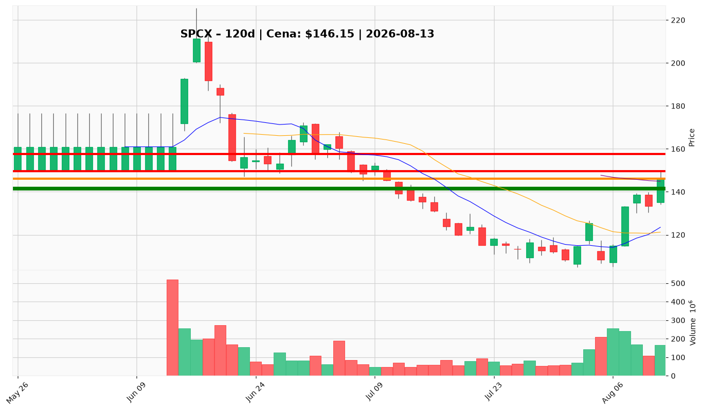

# SPCX — Ticket (2026-08-13)

**Werdykt:** WAIT
**Horyzont:** swing (dni–tygodnie)
**Cena ref.:** $146.15

| | Poziom | Uwagi |
|---|--------|------|
| **Wejście** | $133–$141 (limit) | tylko po korekcie z utrzymaniem powyżej $141,86 (SMA50); nie inicjować longów przy $146 |
| **Stop-loss** | $141.00 | hard invalidation — zamknięcie dzienne poniżej klastra SMA50 / $141–$142 |
| **TP1** | $149.60 | zrealizuj ~50% — szczyt sesji 08-12 / pierwszy opór |
| **TP2** | $157.50 | reszta / trailing — strefa oporu $155–$160 |

**Sizing:** max 0,5–0,75% kapitału (ATR ~$11, ~7,6% ceny); R ≈ 1:1,5–2 przy wejściu w dolnej części strefy
**Warunek aktywacji:** pullback do $133–$141 z utrzymaniem wsparcia powyżej $141,86 po unlockie akcji i potwierdzeniu price action; nie gonić ekstensji powyżej górnej wstęgi Bollingera
**Unieważnienie:** zamknięcie dzienne poniżej $141 otwiera strefę $125–$133 i unieważnia krótkoterminową strukturę odbicia

**Dlaczego (1–2 zdania):** PM i Trader rekomendują Hold — nie otwierać nowych pozycji przy $146 po ~35% odbiciu w uszkodzonym trendzie średnioterminowym; ~79x forward P/E bez marginesu bezpieczeństwa, wyczerpany short squeeze (11% SI) i nadchodzący unlock. Wejście tylko po korekcie zdefiniowanej przez PM.

**WERDYKT KOŃCOWY:** WAIT — obserwuj strefę $133–$141 z potwierdzeniem wsparcia SMA50; nie wchodź przy obecnej cenie $146.

