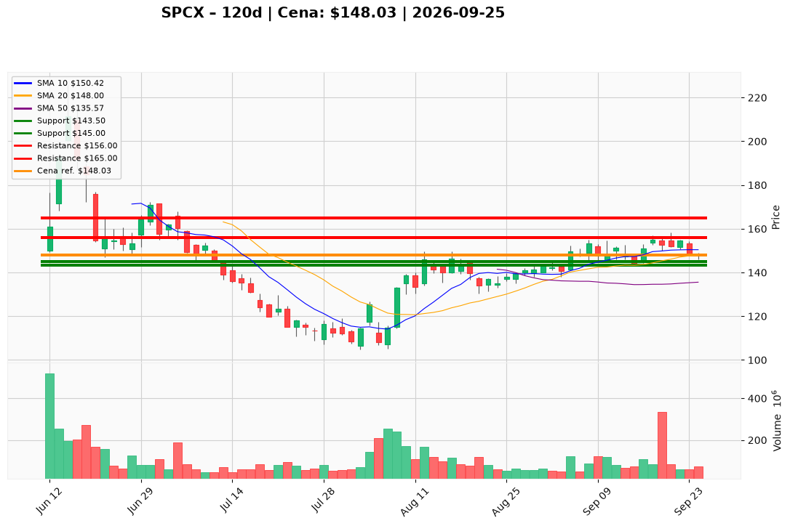

# SPCX — Ticket (2026-09-25)

**Werdykt:** WAIT
**Horyzont:** swing (dni–tygodnie)
**Cena ref.:** $148.03

| | Poziom | Uwagi |
|---|--------|------|
| **Wejście** | $144.00 | limit — potwierdzone utrzymanie wsparcia $143–$145; alternatywa: $151.00 po reclaim VWMA > $150,76 z MACD+ i RSI > 55 |
| **Stop-loss** | $143.50 | hard invalidation (pod środkiem Bollinger / floor konsolidacji 15.09); przy zamknięciu < $145 na rosnącym wolumenie — zacieśnij do $145.00 |
| **TP1** | $156.00 | zrealizuj ~50% (szczyty września / górny Bollinger $155–$157) |
| **TP2** | $165.00 | reszta / trailing (strefa luki czerwca $162–$170 przy potwierdzeniu Colossus 2 Wave 1) |

**Sizing:** 0% nowej ekspozycji przy $148; po triggerze: 25–33% planowanej alokacji swing na $144, reszta po reclaim VWMA > $150,76. Ryzyko max 1,0–1,5% kapitału do SL $143,50 (R ≈ 1:24 z $144). Przy dźwigni 1:5 — licz pozycję od pełnego kapitału, nie od depozytu; nie przekraczaj 1,5% ryzyka equity.
**Warunek aktywacji:** Potwierdzone wsparcie $143–$145 (limit $144) LUB dzienne zamknięcie powyżej VWMA $150,76 z histogramem MACD dodatnim i RSI > 55.
**Unieważnienie:** Dzienne zamknięcie poniżej $143,50 lub Q3 revenue < $6B (niepowtarzalność skoku Q2).

**Dlaczego (1–2 zdania):** PM i Trader: HOLD — Q2 wspiera bias Overweight ($7,81B przychodów +92% r/r, 55,3% marża brutto, ~$93,5B gotówki), ale ~85x forward P/E, −$16,82B FCF kwartalnie i cena w najgorszej strefie R/R ($143–$157, pivot $148) blokują inicjację. Nie gonij rynku — czekaj na trigger przy wsparciu lub reclaim VWMA.

**WERDYKT KOŃCOWY:** WAIT — nie otwieraj longa na $148,03; aktywuj plan dopiero po potwierdzeniu $143–$145 (limit $144) lub breakout momentum powyżej VWMA.

