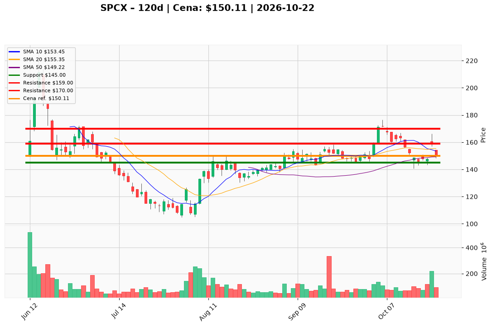

# SPCX — Ticket (2026-10-22)

**Werdykt:** WAIT
**Horyzont:** swing (dni–tygodnie)
**Cena ref.:** $150.11

| | Poziom | Uwagi |
|---|--------|------|
| **Wejście** | $153–$154 | brak nowego market entry; starter tylko po odzyskaniu strefy z stabilizującym się momentum (opcjonalny limit dip ~$147.50 wyłącznie dla resztkowej pozycji, nie chase powyżej ~$153) |
| **Stop-loss** | $145.00 | hard invalidation — sustained daily close poniżej ~$145 przy rosnącym wolumenie (strefa 200 SMA) |
| **TP1** | $159.00 | zrealizuj ~50% — skala w październikowy spike / opór |
| **TP2** | $170.00 | reszta — kierunek wczesno-październikowych swing high ($171–$172) po reclaim krótkoterminowego trendu |

**Sizing:** 0% kapitału na nową inicjację; ewentualny starter po triggerze max 10–15% normalnej wagi jednej spółki, ryzyko od wejścia do SL ≤0,5–1,0% kapitału (ATR szeroki — mniejsza pozycja).
**Warunek aktywacji** (jeśli WAIT): zamknięcie i utrzymanie ~$153–$154 z poprawą momentum (MACD/RSI) **lub** potwierdzenie kroku fundamentalnego w Q3.
**Unieważnienie:** plan martwy przy **daily close < $145** z expanding volume — bias zmienia się na breakdown, cele korekcyjne ~$143–$138.

**Dlaczego (1–2 zdania):** PM/trader: Hold — Q2 pokazuje sensowną infleksję operacyjną, ale jeden kwartał nie dowodzi obrotu przy TTM stracie i wysokim multiple (~73× FWD EPS); technicznie struktura średnioterminowa trzyma SMA, lecz tape krótkoterminowy jest wrogi (poniżej 10 EMA ~$153, MACD pod sygnałem). Nie inicjować pełnego rozmiaru bez reclaimu lub Q3.

**WERDYKT KOŃCOWY:** WAIT — zostań poza rynkiem (0% nowej ekspozycji) do poprawy triggerów; istniejące longi — underweight, honoruj SL $145, trim w siłę ku TP.

