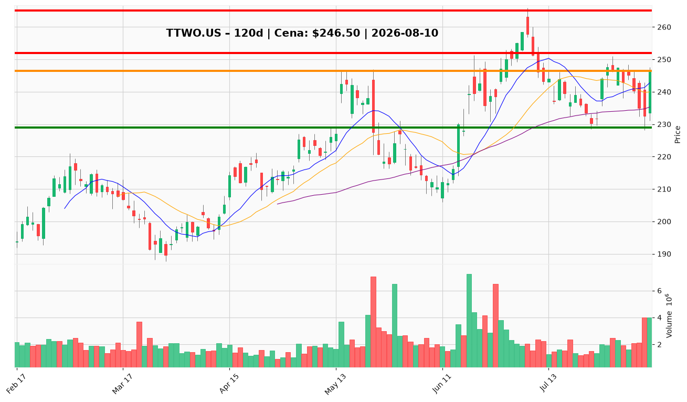

# TTWO.US — Ticket posiadacza (2026-08-10)

**Werdykt:** HOLD
**Horyzont:** swing (dni–tygodnie, do premiery GTA VI 19.11.2026)
**Cena ref.:** $246.50

| | Poziom | Uwagi |
|---|--------|------|
| **Akcja teraz** | Trzymaj | Bez dokupu — czekaj na przebicie $253 na wolumenie |
| **Stop-loss** | $229.00 | Twardy — poniżej 200 SMA i dolnej wstęgi Bollingera |
| **TP1** | $252.00 | Redukcja 30–40% — strefa breakeven / opór |
| **TP2** | $265.00 | Wyjście reszty — szczyt 52-tyg. / re-rating po premierze |

**Pozycja zapisana:** wejście $253.29 | SL $229.00 | TP1 $247.50 | TP2 $265.00

**Sizing / skala:** Utrzymaj obecną alokację. Nie dokupuj. Przy TP1 ($252) sprzedaj 30–40% pozycji, resztę prowadź do $265. Ryzyko na stopie: ~7,1% od ceny ref.

**Warunek dokupu:** Zamknięcie dzienne powyżej $253 z wolumenem >1,5× średniej — potwierdzenie odbicia po wynikach Q1.

**Unieważnienie / pełne wyjście:** Zamknięcie dzienne poniżej $229 lub oficjalne opóźnienie/anulowanie premiery GTA VI.

**Dlaczego (1–2 zdania):** Q1 beat ($1,39B bookings) i rekordowe pre-ordery GTA VI wspierają trzymanie do listopada, ale słabe guidance na Q2 i pełna wycena (PEG 3,44) wykluczają dokup. Odbicie z $232 na 4M wolumenu przywraca trend krótkoterminowy — cierpliwość z dyscypliną SL/TP.

**WERDYKT KOŃCOWY:** HOLD — trzymaj pozycję ze stop-loss $229, realizuj częściowo przy $252, cel główny $265 przed premierą GTA VI.

