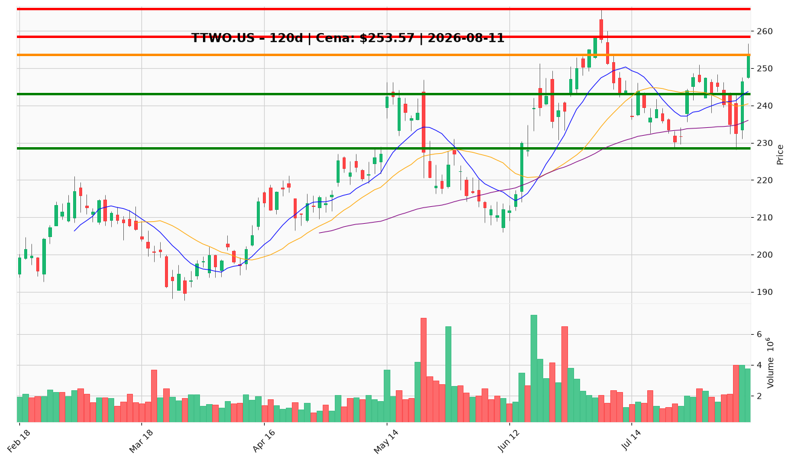

# TTWO.US — Ticket posiadacza (2026-08-11)

**Werdykt:** HOLD (skala-out przy oporze)
**Horyzont:** swing (dni–tygodnie)
**Cena ref.:** $253.57 (zamknięcie 10.08)

**Pozycja zapisana:** wejście $253.29 · SL $229.00 · TP1 $252.00 (zrealizowany — cena już powyżej) · TP2 $265.00

| | Poziom | Uwagi |
|---|--------|------|
| **Akcja teraz** | trzymaj całość | bez nowego kapitału powyżej $256; brak dokupu w obecnej strefie (górna wstęga Bollingera) |
| **Stop-loss** | $228.50 | twardy; domknięcie dzienne poniżej półki $229–232 (200 SMA) kasuje tezę odbicia; domknięcie < $242 = linia wczesnego ostrzeżenia (trim) |
| **TP1** | $258.50 | redukcja 50% przy lipcowym szczycie $258–259 |
| **TP2** | $265.94 | wyjście z reszty przy 52-tyg. szczycie |

**Sizing / skala:** utrzymaj pełną pozycję; redukcja 50% w strefie TP1 ($258–259), reszta przy TP2. Ewentualny dokup wyłącznie w strefie $243–244 (10 EMA / luka z 7.08) przy malejącym wolumenie — max 25% planowanej pozycji. ATR 8.65 → ryzyko ≤ 1R na transakcję.

**Warunek dokupu (ADD):** powrót do $243–244 z kurczącym wolumenem i odbiciem od 10 EMA; brak dokupu powyżej $256.

**Unieważnienie / pełne wyjście:** domknięcie dzienne poniżej $228.50 lub negatywna informacja o GTA VI (przesunięcie daty 19.11, kontrowersja recenzyjna, załamanie pre-orderów) — wyjście z całości.

**Dlaczego (1–2 zdania):** Fundamentalnie katalizator jest potwierdzony (rekordowe pre-ordery GTA VI, beat Q1, konserwatywny guidance FY27 z upside'em wg UBS/Wedbush $300), a trend techniczny jest byczy (powyżej 50/200 SMA, świeży sygnał MACD), ale po +9,6% w dwie sesje akcja jest rozciągnięta przy górnej wstędze Bollingera, wycena pełna (24,6x fwd P/E, brak bufora w GAAP) — stąd trzymanie ze skalowaniem na oporze, nie dokup.

**WERDYKT KOŃCOWY:** HOLD — trzymaj pełną pozycję, scale-out 50% @ $258.50, reszta @ $265.94, twardy SL $228.50; dokup tylko przy $243–244.

