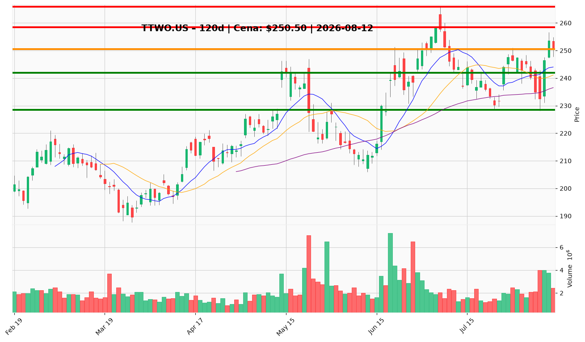

# TTWO.US — Ticket posiadacza (2026-08-12)

**Werdykt:** HOLD (skala-out przy oporze)
**Horyzont:** swing (dni–tygodnie)
**Cena ref.:** $250.50 (zamknięcie 11.08)

**Pozycja zapisana:** wejście $253.29 · SL $228.50 · TP1 $258.50 · TP2 $265.94

| | Poziom | Uwagi |
|---|--------|------|
| **Akcja teraz** | trzymaj całość | bez dokupu powyżej $254; lekki pullback po +9,6% od dołka z 6.08 |
| **Stop-loss** | $228.50 | twardy; poniżej 200 SMA i dolnej wstęgi Bollingera; wczesne ostrzeżenie: zamknięcie < $242 → rozważ redukcję 25% |
| **TP1** | $258.50 | redukcja 50% przy lipcowym szczycie $258–259 |
| **TP2** | $265.94 | wyjście z reszty przy 52-tyg. szczycie |

**Sizing / skala:** utrzymaj pełną pozycję; redukcja 50% w strefie TP1, reszta przy TP2. ATR $8.54 → ryzyko ≤ 1R vs SL. Brak nowego kapitału w obecnej strefie.

**Warunek dokupu (ADD):** powrót do $243–245 (10 EMA) z kurczącym wolumenem; brak dokupu powyżej $254.

**Unieważnienie / pełne wyjście:** zamknięcie dzienne poniżej $228.50 lub negatywna informacja o GTA VI (przesunięcie daty 19.11, załamanie pre-orderów, kontrowersja recenzyjna) — wyjście z całości.

**Dlaczego (1–2 zdania):** Beat Q1 i rekordowe pre-ordery GTA VI potwierdzają katalizator (launch 19.11, UBS/Wedbush widzą upside do $300), trend techniczny byczy (powyżej 50/200 SMA, świeży sygnał MACD), ale niezmieniony guidance FY27 i bliskość górnej wstęgi Bollingera po odbiciu ograniczają dokup — stąd trzymanie ze skalowaniem na oporze.

**WERDYKT KOŃCOWY:** HOLD — trzymaj pełną pozycję, scale-out 50% @ $258.50, reszta @ $265.94, twardy SL $228.50; dokup tylko przy $243–245.

