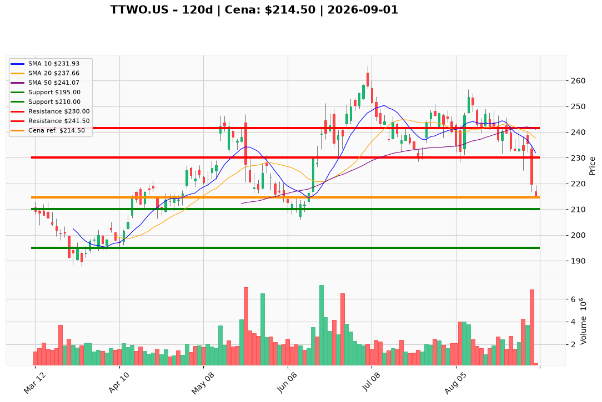

# TTWO.US — Ticket posiadacza (2026-09-01)

**Werdykt:** REDUCE
**Horyzont:** swing (dni–tygodnie)
**Cena ref.:** $214.50

**Pozycje zapisane (3 loty, wszystkie pod wodą):**
- **TTWO.US** — wejście $253.29 · dźwignia 1:1 · SL zapisany $228.50 · TP1 $258.50 · TP2 $265.94
- **TTWO.US#2** — wejście $231.49 · dźwignia 1:5 · SL zapisany $228.50 · TP1 $258.50 · TP2 $265.94
- **TTWO.US#3** — wejście $221.00 · dźwignia 1:5 · SL zapisany $228.50 · TP1 $258.50 · TP2 $265.94

Loty #2 i #3 (1:5) mają podwyższone ryzyko likwidacji — cena $214.50 jest poniżej zapisanego SL $228.50 i blisko strefy przyspieszenia spadku ($210).

| | Poziom | Uwagi |
|---|--------|------|
| **Akcja teraz** | redukcja 30% przy odbiciu do $224–228 | sprzedaj 30% łącznej pozycji na rynku w strefie overhead supply; loty z dźwignią 1:5 priorytetowo w pierwszej redukcji |
| **Stop-loss** | $195.00 | twardy (PM); zamknięcie dzienne < $210 przyspiesza ruch w dół do tego poziomu |
| **TP1** | $230.00 | redukcja części (10 EMA / strefa trimu na relief rally) |
| **TP2** | $241.50 | wyjście z reszty (50 SMA ~$241,07 / Bollinger mid) |

**Sizing / skala:** Po redukcji 30% utrzymaj ~70% core przez launch GTA VI (19.11). Brak nowych longów — 0% kapitału do nowych wejść. Loty 1:5 (#2, #3) traktuj jako najwyższe ryzyko; jeśli brak odbicia do $224–228, rozważ redukcję 30% na rynku bez czekania na bounce, aby ograniczyć ekspozycję likwidacyjną.

**Warunek dokupu (ADD):** odrzucony — brak dokupu do czasu reclaim dolnej wstęgi Bollingera ($219) z malejącym wolumenem i poprawą histogramu MACD. Kontr-trendowe dodatki w $210–215 odrzucone (niekorzystny R/R).

**Unieważnienie / pełne wyjście:** wiarygodna plotka o opóźnieniu GTA VI lub Rockstar przechodzi z „nearly finished” na ogólne „polishing” + zamknięcie dzienne < $210 — przyspiesz redukcje w kierunku gotówki; poniżej $195 pełne wyjście.

**Dlaczego (1–2 zdania):** Techniczny breakdown poniżej 200 SMA ($228) i dolnej wstęgi Bollingera na wolumenie kapitulacji, z rozszerzającym się ujemnym MACD — przy PEG 3,22 i DCF blisko fair value brak bufora na błędy wykonania. Fundamenty GTA VI (90% Ultimate Edition, launch 19.11) uzasadniają core 70%, ale PM Underweight wymaga redukcji 30% w overhead supply.

**WERDYKT KOŃCOWY:** REDUCE — sprzedaj 30% przy odbiciu $224–228 (priorytet loty 1:5), trzymaj 70% core, twardy SL $195, scale-out TP1 $230 / TP2 $241.50; bez dokupów do naprawy struktury.

