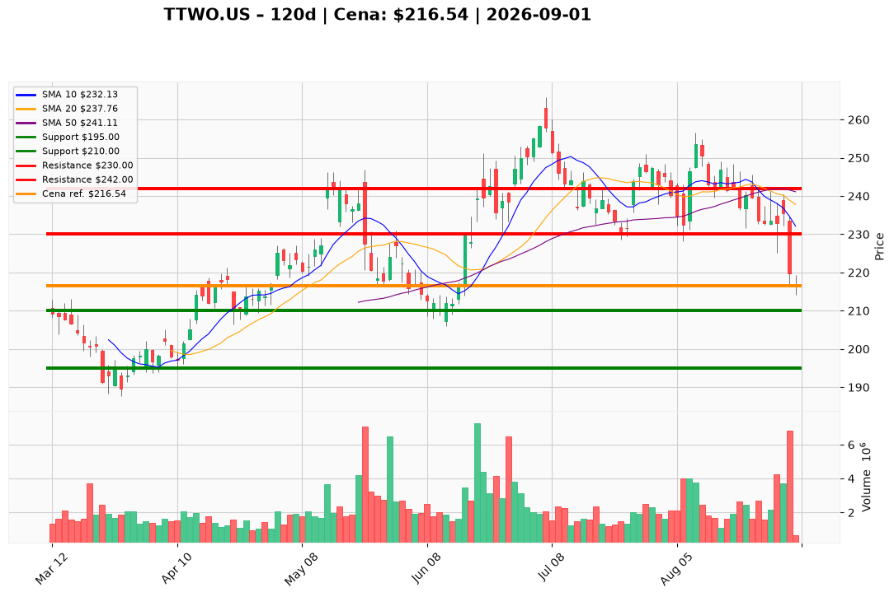

# TTWO.US — Ticket posiadacza (2026-09-01)

**Werdykt:** HOLD (redukcja przy odbiciu)
**Horyzont:** swing (tygodnie–miesiące)
**Cena ref.:** $216.54

**Pozycja zapisana (3 loty):**
- TTWO.US — wejście $253.29 · dźwignia 1:1 · SL $228.50
- TTWO.US#2 — wejście $231.49 · dźwignia 1:5 · SL $228.50
- TTWO.US#3 — wejście $221.00 · dźwignia 1:5 · SL $228.50

| | Poziom | Uwagi |
|---|--------|------|
| **Akcja teraz** | trzymaj rdzeń | bez dokupu; redukcja 15–20% przy odbiciu w strefę $228–$232 |
| **Stop-loss** | $210.00 | twardy; zamknięcie dzienne poniżej unieważnia tezę odbicia i otwiera drogę do $195–$200 |
| **TP1** | $230.00 | redukcja 15–20% przy 10 EMA / pierwszym oporze odbicia |
| **TP2** | $242.00 | wyjście z reszty przy VWMA ($235) / klastrze 50 SMA ($241) |

**Sizing / skala:** Utrzymaj zredukowany rdzeń na katalizator GTA VI (launch 19.11). Loty z dźwignią 1:5 (#2, #3) są pod wodą i blisko strefy $210 — priorytet: ograniczenie ekspozycji, nie dokup. Przy odbiciu do $228–$232 sprzedaj 15–20% całkowitej pozycji, aby obniżyć ryzyko likwidacji na lewarowanych lotach. Brak nowego kapitału poniżej $228–$230 (200 SMA).

**Warunek dokupu (ADD):** tygodniowe zamknięcie powyżej $228–$230 (odbicie 200 SMA) lub kapitulacja w strefie $195–$200 z trzema sesjami stabilizacji — do tego czasu brak dokupu.

**Unieważnienie / pełne wyjście:** zamknięcie dzienne poniżej $210.00 — wyjście z całości; negatywna informacja o GTA VI (przesunięcie daty, załamanie pre-orderów) — natychmiastowe zamknięcie.

**Dlaczego (1–2 zdania):** Teza GTA VI (90% pre-orderów Ultimate Edition, $1,26B TTM FCF) pozostaje ważna, ale wykres jest słaby: kapitulacja 3× wolumen poniżej 200 SMA, MACD −2,52, brak stabilizacji po preview Netflix. Przy 21× forward EPS i PEG 3,22 marża błędu jest cienka — trzymamy rdzeń na launch, ale redukujemy ekspozycję przy odbiciu i honorujemy SL $210.

**WERDYKT KOŃCOWY:** HOLD — trzymaj zredukowany rdzeń, redukcja 15–20% @ $228–$232, twardy SL $210, TP1 $230 / TP2 $242; brak dokupu do odbicia 200 SMA lub kapitulacji $195–$200.

