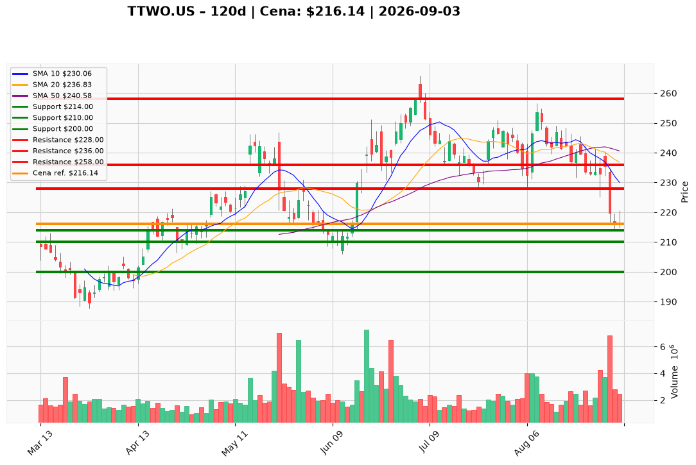

# TTWO.US — Ticket posiadacza (2026-09-03)

**Werdykt:** HOLD (redukcja przy odbiciu)
**Horyzont:** swing (dni–tygodnie)
**Cena ref.:** $216.14

---

## Lot 1 — TTWO.US (bez dźwigni)

**Pozycja zapisana:** wejście $253.29 · P/L: **−14,7%** (−$37,15/akcja)

| | Poziom | Uwagi |
|---|--------|------|
| **Akcja teraz** | trzymaj rdzeń | bez dokupu; redukcja 25–33% przy odbiciu w strefę $228–$236 |
| **Stop-loss** | $214.00 | twardy; zamknięcie dzienne poniżej unieważnia tezę stabilizacji |
| **TP1** | $228.00 | redukcja części (retest 200 SMA) |
| **TP2** | $236.00 | wyjście z reszty (50 SMA / środek pasma Bollingera) |

---

## Lot 2 — TTWO.US#2 (dźwignia 5x)

**Pozycja zapisana:** wejście $231.49 · P/L: **−6,6%** (−$15,35/akcja, ~−33% na kapitale przy 5x)

| | Poziom | Uwagi |
|---|--------|------|
| **Akcja teraz** | trzymaj, priorytet redukcji | lewarowany lot — sprzedaj 25–33% przy pierwszym odbiciu $228+ |
| **Stop-loss** | $214.00 | twardy; ryzyko likwidacji rośnie poniżej $210 |
| **TP1** | $228.00 | redukcja 25–33% |
| **TP2** | $236.00 | wyjście z reszty |

---

## Lot 3 — TTWO.US#3 (dźwignia 5x)

**Pozycja zapisana:** wejście $221.00 · P/L: **−2,2%** (−$4,86/akcja, ~−11% na kapitale przy 5x)

| | Poziom | Uwagi |
|---|--------|------|
| **Akcja teraz** | trzymaj | najmniej pod wodą; ta sama strategia co lot #2 |
| **Stop-loss** | $214.00 | twardy |
| **TP1** | $228.00 | redukcja 25–33% |
| **TP2** | $236.00 | wyjście z reszty |

---

**Sizing / skala:** 0% nowego kapitału. Utrzymaj 67–75% obecnej ekspozycji na katalizator GTA VI (launch 19.11). Loty z dźwignią 5x (#2, #3) — priorytet redukcji przy odbiciu, nie dokup.

**Warunek dokupu (ADD):** zamknięcie dzienne powyżej $220 (potwierdzenie odwrócenia) lub stabilizacja w strefie $200–$203 — do tego czasu brak dokupu.

**Unieważnienie / pełne wyjście:** zamknięcie dzienne poniżej $214 przy wolumenie >2,5M — wyjście z całości; negatywna wiadomość o GTA VI — natychmiastowe zamknięcie.

**Dlaczego (1–2 zdania):** Popyt konsumencki na GTA VI jest rekordowy (31,1M wyświetleń Netflix, ~90% pre-orderów Ultimate Edition), ale akcja nie odbiła po katalizatorze, MACD przyspiesza (−2,75), a wycena ~21× forward EPS nie daje marginesu bezpieczeństwa. Trzymamy rdzeń na launch, redukujemy przy odbiciu i honorujemy SL $214.

**WERDYKT KOŃCOWY:** HOLD — trzymaj rdzeń (67–75%), redukcja 25–33% @ $228–$236, twardy SL $214, TP1 $228 / TP2 $236; brak dokupu do $220+ lub $200–$203.

