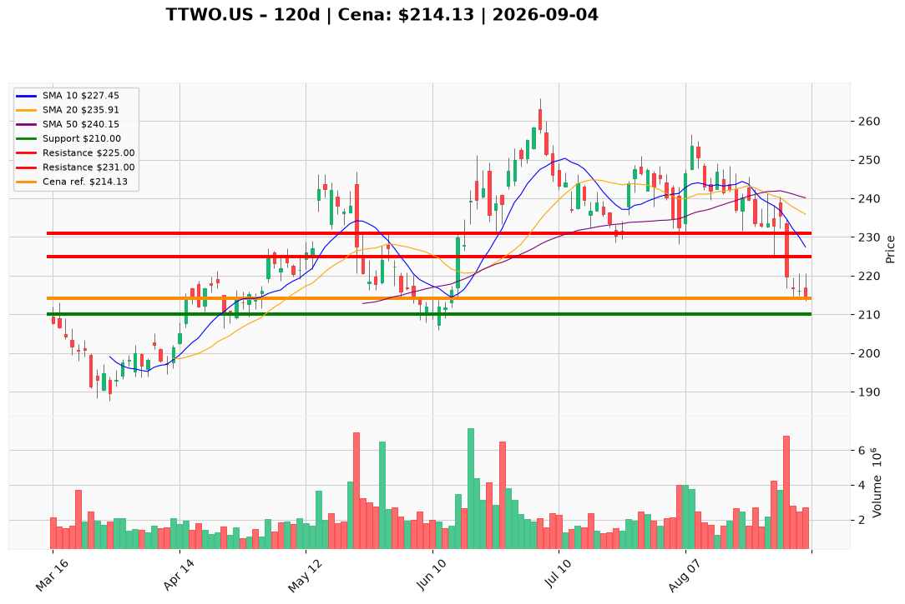

# TTWO.US — Ticket posiadacza (2026-09-04)

**Werdykt:** HOLD
**Horyzont:** swing (dni–tygodnie)
**Cena ref.:** $214.13

**Pozycja zapisana:** wejście $231.49 (TTWO.US#2) · SL $210.00 · P/L: **−7,5%** (−$17,36/akcja)

| | Poziom | Uwagi |
|---|--------|------|
| **Akcja teraz** | trzymaj rdzeń (50–75%) | bez dokupu; redukcja 25–50% przy odbiciu w strefę $225–$231 |
| **Stop-loss** | $210.00 | twardy; zamknięcie dzienne poniżej otwiera drogę do $200–$195 |
| **TP1** | $225.00 | redukcja części (strefa 10 EMA) |
| **TP2** | $231.00 | wyjście z reszty (VWMA / opór wolumenowy) |

**Sizing / skala:** 0% nowego kapitału. Utrzymaj 50–75% ekspozycji na katalizator GTA VI (launch 19.11). Ryzyko max ~1R (~$4/akcja) na ewentualny spekulacyjny dokup po potwierdzeniu technicznym.

**Warunek dokupu (ADD):** brak — czekaj na potwierdzenie odwrócenia (np. zamknięcie dzienne powyżej 10 EMA / stabilizacja trendu) lub oficjalne potwierdzenie terminu launchu.

**Unieważnienie / pełne wyjście:** zamknięcie dzienne poniżej $210; potwierdzone oficjalne opóźnienie GTA VI — natychmiastowe zamknięcie całej pozycji.

**Dlaczego (1–2 zdania):** Teza GTA VI pozostaje (rekordowe preordery, ~$10,30 forward EPS), ale cena 6% poniżej 200 SMA i 12% poniżej 50 SMA z rosnącym MACD (−6,02) oraz dystrybucją instytucjonalną (6,84M akcji 31.08) — momentum nie odwrócone. Trzymaj rdzeń na launch, redukuj przy odbiciu, honoruj SL $210.

**WERDYKT KOŃCOWY:** HOLD — trzymaj rdzeń 50–75%, redukcja 25–50% @ $225–$231, twardy SL $210, TP1 $225 / TP2 $231; brak dokupu przy obecnych poziomach.

