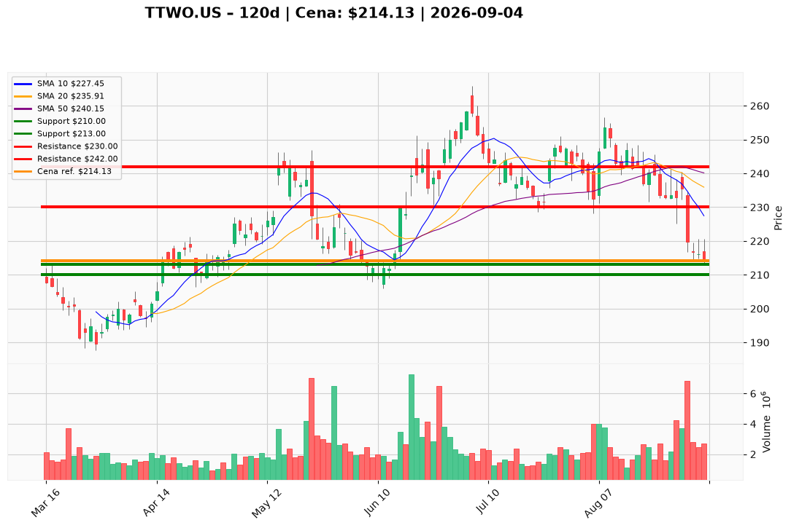

# TTWO.US — Ticket posiadacza (2026-09-04)

**Werdykt:** HOLD
**Horyzont:** swing (dni–tygodnie)
**Cena ref.:** $214.13

**Pozycja zapisana (TTWO.US#3):** wejście $221.00 · P/L: **−3,1%** (−$6,87/akcja, ~−15% na kapitale przy 5x)

| | Poziom | Uwagi |
|---|--------|------|
| **Akcja teraz** | trzymaj | bez dokupu; redukcja 25% przy odbiciu $228–$230 |
| **Stop-loss** | $210.00 | twardy; zamknięcie dzienne poniżej z wolumenem >2,5M |
| **TP1** | $230.00 | redukcja 25% (retest 200 SMA) |
| **TP2** | $242.00 | wyjście z reszty (50 SMA / środek pasma) |

**Sizing / skala:** 0% nowego kapitału. Utrzymaj 100% lotu #3; lewar 5x — priorytet redukcji 25% przy TP1, nie dokup.

**Warunek dokupu (ADD):** zamknięcie dzienne powyżej $220 lub stabilizacja w strefie $200–$203 — do tego czasu brak dokupu.

**Unieważnienie / pełne wyjście:** zamknięcie dzienne poniżej $210 przy wolumenie >2,5M; potwierdzony delay GTA VI — natychmiastowe zamknięcie.

**Dlaczego (1–2 zdania):** GTA VI (launch 19.11) ma rekordowy popyt (~90% pre-orderów Ultimate, 31M wyświetleń Netflix), ale akcja odrzuciła katalizator — RSI 30,5, MACD −6,0, cena pod 200 SMA. Trzymamy lot #3 z SL $210 i celami $230/$242; redukcja przy odbiciu zarządza ryzykiem dźwigni.

**WERDYKT KOŃCOWY:** HOLD — trzymaj lot #3, twardy SL $210, TP1 $230 / TP2 $242, redukcja 25% @ $228–$230, brak dokupu do $220+.

