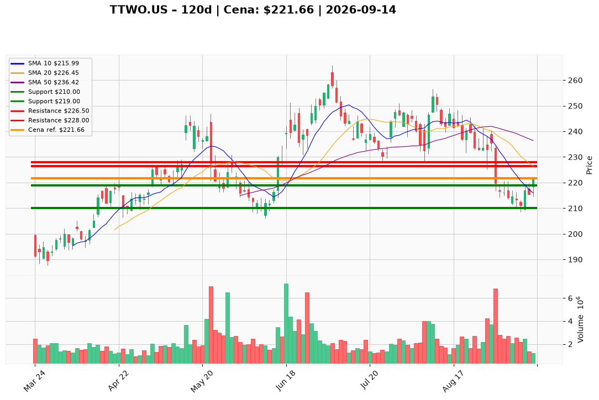

# TTWO.US — Ticket posiadacza (2026-09-14)

**Werdykt:** REDUCE
**Horyzont:** swing (dni–tygodnie)
**Cena ref.:** $221.66

**Pozycja zapisana (TTWO.US):** wejście **$253.29**; SL **$210.00**; TP1 **$230.00**; TP2 **$242.00**.  
P/L vs $221.66: **−$31.63 (−12,5%)**. Zapisane TP1/TP2 są nad rynkiem i nad strefą trimu PM — nie są celem tej sesji.

| | Poziom | Uwagi |
|---|--------|------|
| **Akcja teraz** | sprzedaj ~50% @ $226.50 | limit $226.50–$228.00 (środek BB / SMA 200 $227.33); nie market @ $221.66 |
| **Stop-loss** | $210.00 | twardy dla reszty (pozycja zapisana); wcześniej abort przy close < $219.00, jeśli $226.50 nie tagowane |
| **TP1** | $226.50 | redukcja ~50% |
| **TP2** | $228.00 | górny kraniec strefy trimu; stub ATR zostaje — nie gonić $214.54 / $208.52 resztką longa |

**Sizing / skala:** 0% nowego kapitału. Zredukuj ~50% w $226.50–$228.00, zostaw tylko stub wielkości ~1 ATR ($7.84). Ryzyko 0,5–1,0% kapitału. Nie księguj jako duration na GTA VI (19.11) i nie otwieraj domyślnego shorta.

**Warunek dokupu:** Brak. Add dopiero po zamknięciu na wolumenie >2,5M powyżej $227.33, potem $236.42.

**Unieważnienie / pełne wyjście:** Close < $219.00 bez tagu $226.50 → abort reszty (nie uśredniaj). Close > $227.33, potem $236.42 na >2,5M → plan Underweight pada; nie dokładaj od razu.

**Dlaczego (1–2 zdania):** PM Underweight: close $221.66 nadal pod VWMA $222.62 / SMA 200 $227.33 / SMA 50 $236.42, MACD ujemny, wolumen 1,23M vs 6,84M z 31.08 — magnet $226.50–$228.00 to trim, nie dokup. Fundamenty (TTM EPS −$1.72, ~0,8% FCF yield) nie finansują trzymania pełnego lota z $253.29 przez listopad.

**WERDYKT KOŃCOWY:** REDUCE — sprzedaj ~50% limitem @ $226.50–$228.00 (lot TTWO.US, wejście $253.29, P/L −12,5%); reszta ze SL $210.00, TP1 $226.50 / TP2 $228.00; bez dokupu i bez shorta.

