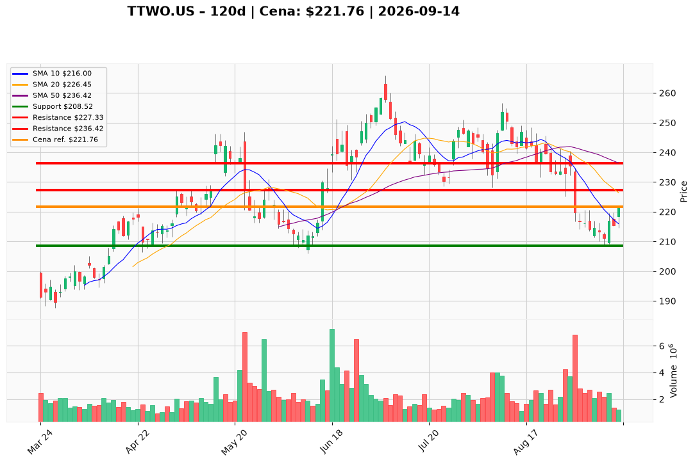

# TTWO.US — Ticket posiadacza (2026-09-14)

**Werdykt:** HOLD
**Horyzont:** swing (dni–tygodnie)
**Cena ref.:** $221.76

**Pozycja zapisana (TTWO.US#2):** wejście **$231.49** · SL zapisany **$210.00** · TP1 zapisany **$225.00** · TP2 zapisany **$231.00** · lewar **5,0x**.  
P/L vs $221.76: **−$9,73/akcja (−4,2% spot, ~−21% na kapitale przy 5x)**. Zapisane TP1/TP2 jeszcze przed rynkiem (225 i 231 > 221,76).

| | Poziom | Uwagi |
|---|--------|------|
| **Akcja teraz** | trzymaj | bez dokupu @ $221.76; nie sprzedawaj market |
| **Stop-loss** | **$208.52** | twardy — zamknięcie dzienne poniżej dołka 9.09 (PM; zapisany $210.00 luzowany o ~$1,50) |
| **TP1** | **$227.33** | redukcja części @ 200 SMA / środek Bollingera (nad zapisanym $225) — nadal poniżej kosztu $231.49 |
| **TP2** | **$236.42** | reszta @ 50 SMA, tylko jeśli zamknięcie 2M+ utrzyma się nad $227.33 |

**Sizing / skala:** 0% nowego kapitału na zamknięciu 14.09. Utrzymaj 100% lotu #2; lewar 5x — priorytet redukcji przy TP1, nie dokup. ATR ~$7,84 ⇒ swing 12–16 pkt jest pogodą, nie sygnałem.
**Warunek dokupu (ADD):** ułamek tylko na cofnięciu **$215–$219** (półka / 10 EMA) przy RSI > ~35, sized do tego samego 1R — nie pełny nowy swing. Przy $221.76 ADD zablokowany.
**Unieważnienie / pełne wyjście:** zamknięcie dzienne **<$208.52** → EXIT (ścieżka ~$204, potem $190s). Samo zejście przez $219.09 nie likwiduje lotu.

**Dlaczego (1–2 zdania):** PM i Trader: HOLD bez pościgu — GTA VI nadal 19.11, ale reszta już w cenie (−13,4% / miesiąc). Bounce 10–14.09 odzyskał 10 EMA przy RSI 44 i cienkim wolumenie 1,23M; MACD bez krzyża. Lot #2 jest pod wodą vs $231.49; nie uśredniać na zamknięciu.

**WERDYKT KOŃCOWY:** **HOLD** — utrzymaj zapisaną pozycję TTWO.US#2 (wejście $231.49; P/L −4,2% / ~−21% przy 5x) bez dokupu @ $221.76; pracuj SL **$208.52** / TP1 **$227.33** / TP2 **$236.42** (zapisane $210 / $225 / $231: cele jeszcze przed nami; SL PM = dołek 9.09).

