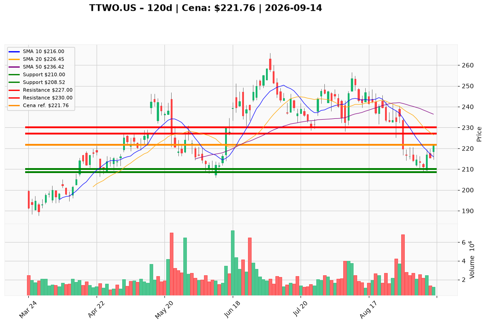

# TTWO.US — Ticket posiadacza (2026-09-14)

**Werdykt:** REDUCE
**Horyzont:** swing (dni–tygodnie)
**Cena ref.:** $221.76

**Pozycja zapisana:** lot **TTWO.US#3** · entry **$221.00** · dźwignia **1:5** · stored SL **$210.00** · stored TP1 **$230.00** · stored TP2 **$242.00**
**P/L vs entry:** **+$0.76** (+0,3% ceny ≈ **+1,7%** na 5×)

| | Poziom | Uwagi |
|---|--------|------|
| **Akcja teraz** | sprzedaj 30–40% limit @ $227 | nie rynek @ $221.76; trim tylko w strefie 226–228, wolumen < ~2,0 mln i RSI bez utrzymania 50 |
| **Stop-loss** | $210.00 | twardy (zapisany); zamknięcie dzienne poniżej — pełne wyjście z reszty |
| **TP1** | $227.00 | redukcja 30–40% (klaster BB mid 226.45 / 200 SMA 227.33) |
| **TP2** | $230.00 | dalsza redukcja reszty stubu; stored TP2 $242 tylko jeśli plan Underweight padnie |

**Sizing / skala:** Po trimie utrzymaj **60–70%** jako stub GTA VI (launch 19.11), sized na bary 15–25 pkt. Brak nowego kapitału. Dźwignia 1:5: odcinek 221→210 to ~5% ceny ≈ **~25%** na lot — honoruj SL, nie dokupuj.

**Warunek dokupu (ADD):** brak — nie gonić $221.76. Dokup odrzucony do czasu held close **>$228** na ≥2,0–2,5 mln z histogramem MACD na plus (wtedy Underweight jest martwy).

**Unieważnienie / pełne wyjście:** zamknięcie dzienne **<$210**; oficjalne opóźnienie GTA VI — wyjście natychmiast. Nie dumpować przez $219 „na słabości”. Plan redukcji pada przy held close **>$228** na wolumenie — wtedy trzymaj resztę ze stored TP2 $242 i SL $210.

**Dlaczego (1–2 zdania):** PM Underweight: 221.76 to niski wolumen na 10-EMA w wciąż niedźwiedzim stosie 50/200, nie odwrócenie — jedyna dozwolona ekspresja to trim w 226–228, nie short przez 219 i nie exit IP. Stub na GTA zostaje; lewarowany lot #3 schodzi przy bounce, nie przy dołku.

**WERDYKT KOŃCOWY:** REDUCE — sprzedaj 30–40% @ $227 (strefa 226–228), trzymaj 60–70% stub GTA, twardy SL $210, TP1 $227 / TP2 $230; bez dokupu i bez sprzedaży @ $221.76.

