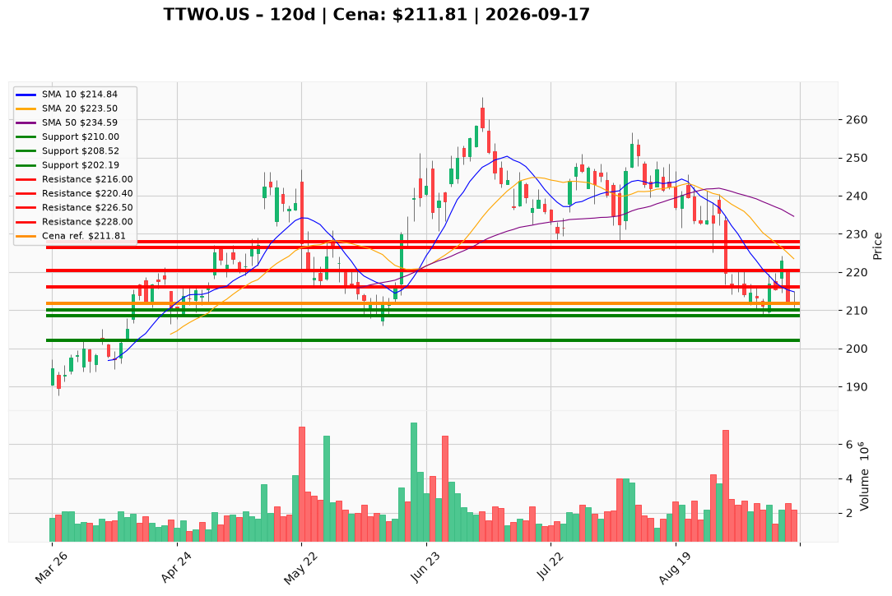

# TTWO.US — Ticket posiadacza (2026-09-17)

**Werdykt:** HOLD
**Horyzont:** swing (dni–tygodnie)
**Cena ref.:** $211.81

**Pozycja zapisana (TTWO.US):** wejście **$253.29**; SL **$210.00**; TP1 **$226.50**; TP2 **$228.00**.  
P/L vs $211.81: **−$41.48 (−16,4%)**.

| | Poziom | Uwagi |
|---|--------|------|
| **Akcja teraz** | trzymaj | brak dokupu; obrona SL $210.00 |
| **Stop-loss** | $210.00 | twardy — wyjście przy close dzienny < $210.00 |
| **TP1** | $226.50 | redukcja 30–50% przy odbiciu |
| **TP2** | $228.00 | trim reszty / górny kraniec strefy |

**Sizing / skala:** 0% nowego kapitału. Utrzymaj istniejący lot; ryzyko 0,5–1,0% kapitału na ewentualny breach SL. Nie dokładaj — cena pod SMA 200 ($227.03), VWMA ($220.40) i SMA 50 ($234.59).

**Warunek dokupu:** Brak. Add dopiero po zamknięciu > $220.00 na wolumenie >2,5M.

**Unieważnienie / pełne wyjście:** Close dzienny < $210.00 → wyjście 100% (nie uśredniaj). Dwa odrzucenia $216.00 bez tagu TP → rozważ redukcję 25% przed SL.

**Dlaczego (1–2 zdania):** PM Hold: RSI 36,9 i kurczący się histogram MACD wspierają odbicie do $226,50–$228,00, ale spadek pod SMA 200 na podwyższonym wolumenie oraz ujemny FCF Q2 blokują dokup. Przy wejściu $253,29 plan jest obronny — trzymaj przy SL $210, tnij na TP.

**WERDYKT KOŃCOWY:** HOLD — trzymaj lot TTWO.US (wejście $253.29, P/L −16,4%) ze SL $210.00; TP1 $226.50 / TP2 $228.00; bez dokupu; wyjście przy close < $210.00.

