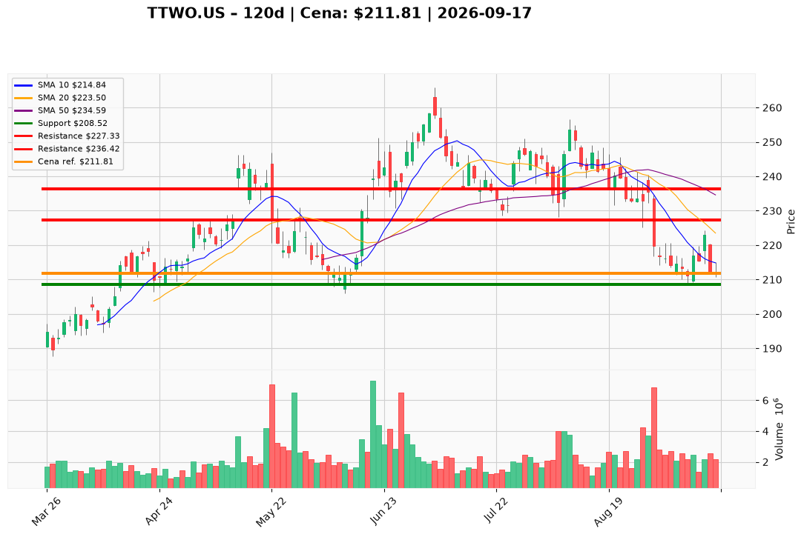

# TTWO.US — Ticket posiadacza (2026-09-17)

**Werdykt:** HOLD
**Horyzont:** swing (dni–tygodnie)
**Cena ref.:** $211.81

**Pozycja zapisana (TTWO.US#2):** wejście **$231.49**; SL **$208.52**; TP1 **$227.33**; TP2 **$236.42**.  
P/L vs $211.81: **−$19.68 (−8,5%)**.

| | Poziom | Uwagi |
|---|--------|------|
| **Akcja teraz** | trzymaj | bez dokupu @ $211.81; tape pod wszystkimi MA |
| **Stop-loss** | $208.52 | twardy (dołek 09.09); ~1,5% poniżej ceny ref. |
| **TP1** | $227.33 | redukcja ~25–30% (SMA 200 / środek BB) |
| **TP2** | $236.42 | reszta przy odbiciu do SMA 50 |

**Sizing / skala:** 0% nowego kapitału. Trzymaj pełny lot #2 ze SL $208.52. Ryzyko pozycji do SL: ~9,9% od wejścia $231.49. Nie uśredniaj w dół.

**Warunek dokupu:** Brak. Add dopiero po zamknięciu dziennego > $227.33 (SMA 200) na wolumenie >2,5M.

**Unieważnienie / pełne wyjście:** Close dzienny < $208.52 na rosnącym wolumenie → wyjście 100%. GTA VI (19.11) to okno binarne — nie zwiększaj ekspozycji przed reclaim SMA 200.

**Dlaczego (1–2 zdania):** PM Hold: RSI 36,88 (wyprzedanie) i FCF $1,26B uzasadniają trzymanie lotu z SL $208.52 przez okno GTA VI, ale tape pozostaje złamany (MACD −6,69, cena pod SMA 10/50/200) — bez dokupu i z redukcją częściową dopiero przy TP1.

**WERDYKT KOŃCOWY:** HOLD — trzymaj lot TTWO.US#2 (wejście $231.49, P/L −8,5%) ze SL $208.52; TP1 $227.33 / TP2 $236.42; bez dokupu do reclaim SMA 200.

