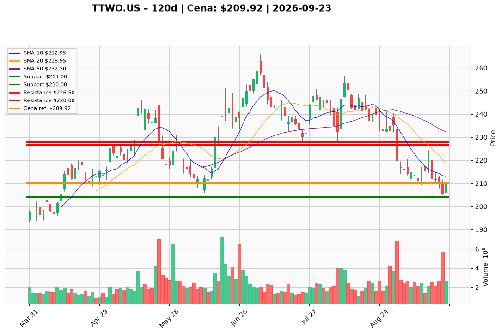

# TTWO.US — Ticket posiadacza (2026-09-23)

**Werdykt:** HOLD
**Horyzont:** swing (dni–tygodnie)
**Cena ref.:** $209.92

**Pozycja zapisana (TTWO.US):** wejście **$253.29**; SL **$210.00** (zaktualizowany przez PM → **$204.00**); TP1 **$226.50**; TP2 **$228.00**.  
P/L vs $209.92: **−$43.37 (−17,1%)**.

| | Poziom | Uwagi |
|---|--------|------|
| **Akcja teraz** | trzymaj | bez dokupu; SL $210 przebity (close $209.92) — PM obniża twardy stop do $204 (dołek 21.09) |
| **Stop-loss** | $204.00 | twardy (poniżej dołka $204.00); wyjście przy close < $204 |
| **TP1** | $226.50 | redukcja części (200 SMA $226.45) |
| **TP2** | $228.00 | wyjście reszty / górny kraniec strefy swing |

**Sizing / skala:** 0% nowego kapitału. Trzymaj pełny lot. Ryzyko od $209.92 do $204 ≈ 2,8%. Nie dokupuj — trend pod wszystkimi MA, TTM EPS −$1.72.

**Warunek dokupu:** Brak. Add dopiero po zamknięciu na wolumenie >2,5M powyżej $218.00 (nie dotyczy tego lotu −17% pod wodą).

**Unieważnienie / pełne wyjście:** Close < $204.00 → wyjście 100% na market (nie uśredniaj). Brak reclaim $210 w ciągu 2 sesji + close < $204 → abort bez czekania.

**Dlaczego (1–2 zdania):** PM Hold: lot przy $253.29 jest −17,1% pod wodą, ale Sep 21 utrzymał dołek $204, histogram MACD kurczy się (−0.46 vs −2.7), GTA VI potwierdzone — warunkowy hold z obniżonym SL $204 zamiast przebytego $210. Odbicie do TP1 $226.50 możliwe, ale bez dokupu.

**WERDYKT KOŃCOWY:** HOLD — trzymaj lot TTWO.US (wejście $253.29, P/L −17,1%) ze SL $204.00, TP1 $226.50 / TP2 $228.00; bez dokupu, wyjście przy close < $204.

