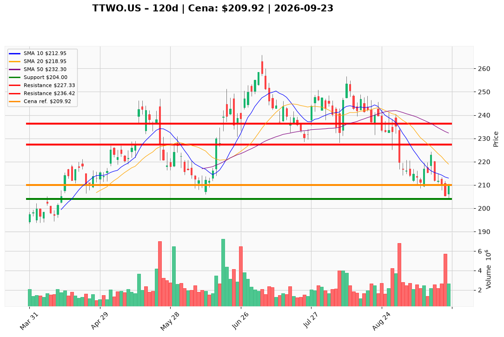

# TTWO.US — Ticket posiadacza (2026-09-23)

**Werdykt:** HOLD
**Horyzont:** swing (dni–tygodnie)
**Cena ref.:** $209.92

**Pozycja zapisana (TTWO.US#2):** wejście **$231.49**; SL **$204.00**; TP1 **$227.33**; TP2 **$236.42**.  
P/L vs $209.92: **−$21.57 (−9,3%)**.

| | Poziom | Uwagi |
|---|--------|------|
| **Akcja teraz** | trzymaj | bez dokupu; oczekuj odbicia w kierunku VWMA $213 / TP1 $227 |
| **Stop-loss** | $204.00 | twardy (poniżej dołka 18–21.09 $204–$205); wyjście przy close < $204 |
| **TP1** | $227.33 | redukcja ~25–30% (SMA 200 / zapisany cel) |
| **TP2** | $236.42 | wyjście reszty (SMA 50 / zapisany cel) |

**Sizing / skala:** 0% nowego kapitału. Trzymaj pełny lot #2. Ryzyko od ceny ref. do SL: ~2,8%. Nie uśredniaj w dół.

**Warunek dokupu:** Brak. Add dopiero po zamknięciu dziennego > $227.33 (SMA 200) na wolumenie >2,5M.

**Unieważnienie / pełne wyjście:** Close dzienny < $204.00 → wyjście 100% (poprzedni SL $208.52 naruszony 18.09 — PM obniża do $204). Brak reclaim $213 (10 EMA) w ciągu 5 sesji + close < $204 → abort bez czekania.

**Dlaczego (1–2 zdania):** PM Hold: lot #2 przy $231.49 jest −9,3% pod wodą, ale odbicie 21.09 (+2,18%) od dołka $204 i kurczenie histogramu MACD (−0,46 vs −2,73) sugerują wyczerpanie presji sprzedaży — baza pod odbicie do TP1 $227. Trend nadal pod wszystkimi MA i TTM EPS −$1,72 nie uzasadnia dokupu; FCF $1,26B + GTA VI (19.11) wspierają trzymanie ze SL $204.

**WERDYKT KOŃCOWY:** HOLD — trzymaj lot TTWO.US#2 (wejście $231.49, P/L −9,3%) ze SL $204.00, TP1 $227.33 / TP2 $236.42; bez dokupu, wyjście przy close < $204.

