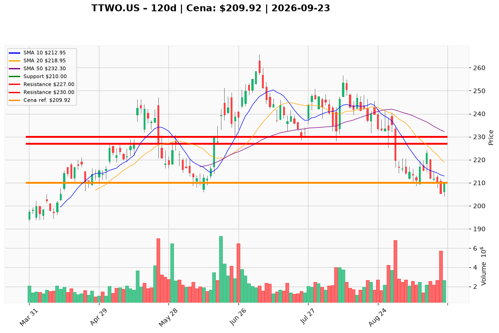

# TTWO.US — Ticket posiadacza (2026-09-23)

**Werdykt:** HOLD
**Horyzont:** swing (dni–tygodnie)
**Cena ref.:** $209.92

**Pozycja zapisana (TTWO.US#3):** wejście **$221.00**; SL **$210.00**; TP1 **$227.00**; TP2 **$230.00**.  
P/L vs $209.92: **−$11.08 (−5,0%)**.

| | Poziom | Uwagi |
|---|--------|------|
| **Akcja teraz** | trzymaj | bez dokupu; czekaj na odbicie w kierunku 10 EMA $213 / VWMA $213 |
| **Stop-loss** | $210.00 | twardy (poniżej dołka 16.09 $210.72); wyjście przy close < $210 |
| **TP1** | $227.00 | redukcja części (200 SMA $226.45) |
| **TP2** | $230.00 | wyjście reszty / górny kraniec strefy swing |

**Sizing / skala:** 0% nowego kapitału. Trzymaj pełny lot #3. Ryzyko ~5% na lot ($221 → $210). Nie księguj jako duration na GTA VI — to swing z twardym SL.

**Warunek dokupu:** Brak. Add dopiero po zamknięciu na wolumenie >2,5M powyżej $217.00 (reclaim 10 EMA).

**Unieważnienie / pełne wyjście:** Close < $210.00 → wyjście ze stopa (nie uśredniaj). Brak reclaim $217 w ciągu 5 sesji + close < $210 → abort bez czekania na $204.

**Dlaczego (1–2 zdania):** PM Hold: lot #3 przy $221 jest −5,0% pod wodą, SL $210 trzyma (dołek $210.72), histogram MACD kurczy się (−0.46 vs −2.7), RSI 38 blisko wyprzedania — baza pod odbicie do TP1 $227. Trend nadal pod wszystkimi MA i TTM EPS −$1.72 nie uzasadnia dokupu; data GTA VI potwierdzona na AGM.

**WERDYKT KOŃCOWY:** HOLD — trzymaj lot TTWO.US#3 (wejście $221.00, P/L −5,0%) ze SL $210.00, TP1 $227.00 / TP2 $230.00; bez dokupu, wyjście przy close < $210.

